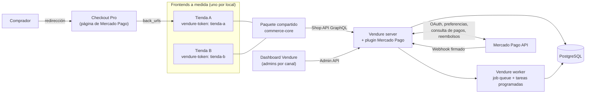
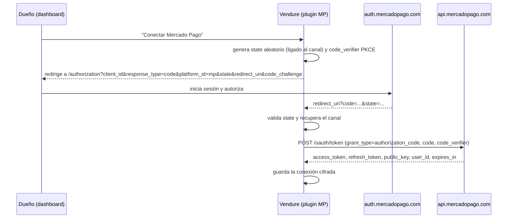
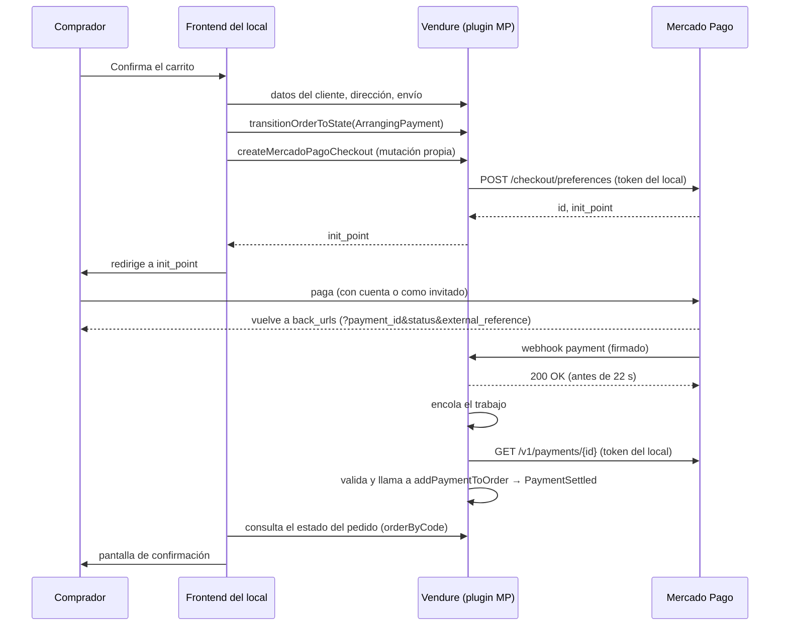

# Especificación técnica: servicio de tiendas virtuales para locales comerciales

| | |
|---|---|
| **Responsable** | Javier Debórtoli (proyecto personal) |
| **Versión** | 1.1 (MVP) |
| **Fecha** | 18 de octubre de 2026 |
| **Estado** | Firme para el MVP, con los puntos de la sección 13 a verificar en sandbox |
| **Stack verificado** | TypeScript sobre Node.js 24 LTS, Vendure 3.8, PostgreSQL 17, Mercado Pago Argentina (Checkout Pro vía Preferences API) con el SDK `mercadopago` 3.x. Detalle en la sección 16 |

Convención usada en este documento:
- **[Doc]**: comportamiento confirmado en la documentación oficial (ver sección 17).
- **[Diseño]**: decisión propia de esta especificación, no viene de la documentación.
- **[Verificar]**: supuesto razonable que hay que confirmar en sandbox antes de salir a producción.

---

## 1. Objetivo

Ofrecer a locales comerciales de Argentina tiendas online con **diseño a medida por cliente** (no plantillas parametrizables), sobre un **backend de comercio compartido y multi-tenant**, cobrando con **Mercado Pago** directamente en la cuenta de cada local.

El diferencial comercial es el frontend único por cliente. Todo lo demás (catálogo, pedidos, pagos, panel) es infraestructura común que se mantiene una sola vez.

## 2. Alcance

### Incluido en el MVP
- Backend Vendure único con un canal por local.
- Panel de administración por local (dashboard de Vendure con rol limitado a su canal).
- Frontend a medida por local, que consume un paquete compartido de lógica de comercio.
- Compra como invitado por defecto, con cuenta opcional compartida entre tiendas (sección 6).
- Pago con Mercado Pago Checkout Pro, cobrando en la cuenta del local (vinculada por OAuth).
- Reembolsos y cancelaciones desde el panel.
- Entrega por retiro en el local o envío con tarifa fija.

### Fuera del MVP
- Comisión por venta (split o `marketplace_fee`). El servicio se cobra con abono aparte.
- Pago embebido en el sitio (Checkout Bricks o Checkout API).
- Cotización automática con correos (Andreani, Correo Argentino, agregadores).
- Facturación electrónica de ARCA.
- Otras pasarelas (Ualá Bis, Payway), aunque la capa de pagos queda preparada para sumarlas.

## 3. Decisiones tomadas

| # | Decisión | Motivo |
|---|---|---|
| D1 | Backend: **Vendure**, una sola instancia con un **canal por local** | Los canales están pensados para multi-tenancy: cada uno tiene sus propios productos, métodos de envío y de pago [Doc] |
| D2 | **Frontend a medida por cliente** | Diferencial del servicio frente a los que usan una plantilla parametrizable |
| D3 | Lógica de carrito, checkout y pagos en un **paquete compartido** que usan todos los frontends | Un bug o un cambio de Mercado Pago se corrige una sola vez [Diseño] |
| D4 | **Mercado Pago Checkout Pro vía Preferences API** | Lo más simple de integrar, los datos de tarjeta no pasan por nuestro sistema, y la comisión de marketplace (para el futuro) está documentada para `/checkout/preferences` en Argentina [Doc] |
| D5 | Cada local cobra en **su propia cuenta**, vinculada por **OAuth** | Para operar en nombre de cada vendedor hay que usar su access token obtenido por OAuth [Doc]. No manejamos dinero de terceros |
| D6 | **Abono aparte** como modelo de cobro del servicio | Evita depender del split, que tiene restricciones dudosas en Argentina (sección 13) |
| D7 | Compradores: **invitado por defecto + cuenta opcional compartida** entre tiendas | Decisión de producto. Encaja con cómo Vendure modela los usuarios (sección 6) |
| D8 | Entrega: **retiro en el local** y **envío con tarifa fija** | Decisión de producto. Cubre a la mayoría de los locales chicos |
| D9 | Stack: **TypeScript estricto** sobre **Node.js 24 LTS**, monorepo con **npm workspaces**, **PostgreSQL 17**, empaquetado con **Docker** (sección 16) | Es el stack nativo de Vendure y del SDK de Mercado Pago. npm es el gestor que usan el instalador y las guías de Docker de Vendure, mientras que pnpm no figura en su documentación [Doc] |

## 4. Arquitectura



Componentes:
- **Vendure server**: expone la Shop API (tiendas) y la Admin API (gestión), ambas en GraphQL [Doc]. Incluye el plugin propio de Mercado Pago.
- **Vendure worker**: procesa la cola de trabajos (webhooks) y las tareas programadas (renovación de tokens) [Diseño, sobre funciones de Vendure].
- **PostgreSQL**: base oficialmente soportada junto con MySQL/MariaDB y SQLite [Doc].
- **Frontends**: uno por local, con cualquier framework. Hablan solo con la Shop API.
- **Stack tecnológico** de cada componente: sección 16.

## 5. Multi-tenancy

### 5.1 Un canal por local
- Cada local es un **Channel** con su **Seller** asignado [Doc]. El Seller se puede extender con campos personalizados (logo, contacto, CUIT) [Doc].
- Configuración del canal: moneda por defecto **ARS**, idioma español y precios con IVA incluido [Diseño].
- El frontend elige el canal enviando el encabezado `vendure-token` en cada llamada. La respuesta trae solo las entidades asignadas a ese canal [Doc].

### 5.2 Reglas sobre el canal por defecto
- El canal por defecto contiene **todas** las entidades, y un producto creado en un canal secundario **siempre queda asignado también al canal por defecto** [Doc].
- Por eso:
  - **Ningún frontend usa el token del canal por defecto.** Queda solo para el superadmin.
  - Como todos los canales usan ARS, el precio que se replica en el canal por defecto no genera inconsistencias de moneda [Diseño].

### 5.3 Administradores por local
- Cada local tiene un **Administrator** con un **Role limitado a su canal**. Un rol así no tiene visibilidad sobre otros canales ni sobre el canal por defecto [Doc].
- El superadmin (Javier) tiene el rol SuperAdmin, con acceso a todos los canales [Doc].

### 5.4 Alta de un local
Un script o mutación interna del superadmin crea, en una sola operación [Diseño, siguiendo el ejemplo oficial de multi-vendor [Doc]]:
1. Seller
2. Channel (token único, ARS, español)
3. Role limitado al canal y Administrator del dueño
4. StockLocation del local
5. ShippingMethods: retiro en el local y envío con tarifa fija (sección 8)
6. PaymentMethod con el handler `mercado-pago` asignado al canal

Después, el dueño entra al dashboard y conecta su cuenta de Mercado Pago (sección 9.2).

### 5.5 Entidades que se separan por canal
Asset, Collection, Customer, Facet, FacetValue, Order, PaymentMethod, Product, ProductVariant, Promotion, Role, ShippingMethod y StockLocation [Doc].

## 6. Compradores (modelo híbrido)

### 6.1 Cómo lo modela Vendure
- **User** es la identidad (credenciales), única en todo el servidor. **Customer** y **Administrator** apuntan a un User [Doc].
- La **compra como invitado** está soportada: el Customer tiene email pero no User [Doc].
- Si un invitado se registra después con el mismo email, Vendure vincula el nuevo User con el Customer existente y conserva su historial [Doc].
- Por defecto, un cliente autenticado queda **asignado automáticamente** a cualquier canal en el que inicie sesión [Doc]. Desde la v3.7 eso se puede cambiar con `CustomerChannelAssignmentStrategy`, pero esa estrategia controla la pertenencia al canal, no el acceso a la API [Doc].

### 6.2 Comportamiento del MVP
- **Por defecto, la tienda funciona como invitado**: el checkout pide email, nombre y datos de entrega, sin crear cuenta.
- **Cuenta opcional**: el comprador puede registrarse. Esa cuenta **es la misma en todas las tiendas** de la plataforma.
- Se mantiene `DefaultCustomerChannelAssignmentStrategy`. Cuando el comprador inicia sesión en otra tienda, queda asignado a ese canal y ese local empieza a verlo como cliente [Doc].
- Los pedidos son por canal: un local no ve los pedidos que el comprador hizo en otra tienda [Doc, porque Order está separado por canal].

### 6.3 Consecuencias de producto [Diseño]
- La cuenta tiene que presentarse como **cuenta de la plataforma** (con un nombre de marca propio), no como "cuenta de la Tienda A". Si no, el comprador se va a sorprender cuando su contraseña funcione en otra tienda.
- Los términos y la política de privacidad tienen que aclarar que la cuenta es compartida y que cada local ve los datos del comprador solo después de que este interactúe con su tienda.
- Los emails transaccionales (verificación, recuperación de contraseña) llevan la marca de la plataforma. Los de pedido llevan la marca del local.

## 7. Catálogo, stock y promociones

Se usa lo que trae Vendure sin modificaciones: productos y variantes, campos personalizados, control de stock, búsqueda por facetas, colecciones y promociones, todo por canal [Doc].

Montos [Diseño]: Vendure guarda los importes como enteros en la unidad menor de la moneda (centavos). El `unit_price` de Mercado Pago es decimal, así que el plugin convierte con `importe / 100` al armar la preferencia. [Verificar] el redondeo con precios que tengan centavos.

## 8. Entregas

Cada ShippingMethod combina un *checker* (si aplica al pedido) y un *calculator* (cuánto cuesta), y se puede restringir por zonas [Doc].

| Método | Checker | Calculator |
|---|---|---|
| Retiro en el local | Siempre elegible | Precio 0 |
| Envío con tarifa fija | Por zona geográfica. Opcional: checker propio de monto mínimo | Tarifa fija configurada por el local |

- El calculator de tarifa fija es el de Vendure por defecto [Verificar que su comportamiento sea exactamente precio fijo].
- Un checker de monto mínimo, si hace falta, se implementa como `ShippingEligibilityChecker` propio [Doc, por el mecanismo de extensión].
- Más adelante, la cotización con correos se puede sumar como `ShippingCalculator` propio que llame a una API externa, sin tocar los frontends [Doc].

## 9. Pagos con Mercado Pago

### 9.1 Modelo
- Una sola **aplicación de Mercado Pago** registrada en la cuenta de vendedor de Javier (client_id, client_secret, clave secreta de webhooks).
- [Diseño] Antes de vincular al primer local, conviene decidir a nombre de quién queda esa aplicación. Si más adelante el proyecto pasa a una sociedad o a otra cuenta, una aplicación nueva tiene otro client_id, y cada local tendría que volver a autorizar por OAuth.
- Cada local vincula **su cuenta** a esa aplicación por OAuth. Los pagos se crean con el access token del local, así que el dinero va a su cuenta [Doc].
- Sin `marketplace_fee` en el MVP (D6).

### 9.2 Vinculación OAuth (flujo authorization code)



Requisitos confirmados [Doc]:
- La `redirect_uri` tiene que ser **estática** y coincidir exactamente con la configurada en la aplicación. Cualquier dato extra (como el canal) viaja en `state`.
- El `code` recibido es válido por **10 minutos**, así que el canje se hace en el momento.
- El **access token dura 180 días**.
- PKCE es opcional pero recomendado. Se habilita en los detalles de la aplicación y usa `code_challenge` y `code_challenge_method` (S256).
- Para sandbox, el canje acepta `test_token: true`.

Decisión [Diseño]: se usa PKCE con S256, y el `state` se guarda en el servidor con un vencimiento corto y un solo uso.

Regla [Diseño]: **una cuenta de Mercado Pago corresponde a una sola tienda.** El webhook llega a nivel aplicación y se asigna al local por el `user_id` del vendedor (sección 9.7), así que si dos canales compartieran el mismo `user_id` no habría forma de saber a cuál pertenece la notificación. Por eso:
- `mpUserId` es único en la base (sección 9.3).
- Si al terminar el OAuth el `user_id` recibido ya está vinculado a **otro** canal, la vinculación se rechaza con un mensaje claro y no se guarda nada.
- Si el `user_id` ya está vinculado al **mismo** canal, es una reconexión y se actualizan los tokens.
- Un dueño con dos locales necesita una cuenta de Mercado Pago distinta para cada uno.

### 9.3 Almacenamiento de credenciales [Diseño]
Las credenciales **no** se guardan en los argumentos del PaymentMethod, porque vencen y se rotan. Se usa una entidad propia del plugin:

| Campo | Notas |
|---|---|
| `channelId` | Único |
| `mpUserId` | **Único.** Sirve para identificar al local cuando llega un webhook |
| `accessToken` | Cifrado (AES-256-GCM, clave en variable de entorno) |
| `refreshToken` | Cifrado |
| `publicKey` | |
| `expiresAt` | Calculado a partir de `expires_in` |
| `scope` | Tiene que incluir `offline_access` |
| `status` | `connected`, `expiring`, `disconnected` |

### 9.4 Renovación de tokens
- La renovación usa `grant_type=refresh_token` y devuelve un access token nuevo **y un refresh token nuevo, que hay que volver a guardar** [Doc].
- Solo funciona si la aplicación recibió el scope `offline_access` y el vendedor lo autorizó [Doc].
- [Diseño] Una tarea programada diaria en el worker renueva las conexiones que venzan en menos de 30 días. Si falla, marca la conexión como `expiring` y avisa al local y al superadmin para que vuelva a conectar.
- [Diseño] Se escucha el tópico `mp-connect` (vinculación y desvinculación de cuentas OAuth) [Doc] para marcar `disconnected` si el local revoca el acceso. Mientras esté desconectado, el método de pago queda no elegible en ese canal.

### 9.5 Handler de pago en Vendure
Vendure trae solo un handler de prueba, y cada integración se escribe como un `PaymentMethodHandler` [Doc]. Funciones del handler `mercado-pago`:

| Función | Uso en esta integración |
|---|---|
| `createPayment` | Se llama **desde el webhook** (no desde el frontend) cuando el pago ya está aprobado. Devuelve `state: 'Settled'`, `transactionId` = id del pago en Mercado Pago, y `amount` |
| `settlePayment` | Devuelve `{ success: true }`, porque el pago llega ya capturado. Así está documentado para las integraciones que capturan al crear [Doc] |
| `cancelPayment` | Opcional [Doc]. Cancela pagos `pending` o `in_process` en Mercado Pago |
| `createRefund` | Opcional [Doc]. Llama a `POST /v1/payments/{id}/refunds` con el token del local |

Es el patrón de **página de pago alojada** que describe Vendure: el pago ya está autorizado cuando vuelve la notificación, la validación ocurre en un controlador o servicio, y el handler solo registra los datos [Doc]. El plugin oficial de Mollie usa la misma forma: una mutación que crea el "intent" y devuelve la URL, la redirección y el webhook que actualiza el pedido [Doc].

### 9.6 Flujo de compra (Checkout Pro)



Detalle de cada paso:

1. **Preparación**: el frontend completa cliente, dirección y método de envío, y pasa el pedido a `ArrangingPayment`, el estado en el que se consultan los métodos de pago elegibles [Doc]. Desde Vendure 3.8, al pasar a `ArrangingPayment` el pedido se recalcula y se vuelve a comprobar que el método de envío siga siendo elegible [Doc, notas de la versión 3.8.0]. El frontend tiene que manejar el error si el envío deja de ser elegible en ese punto [Verificar el error que devuelve la API].
2. **Creación de la preferencia** (mutación propia de la Shop API, `createMercadoPagoCheckout`) [Diseño]:
   - `items`: líneas del pedido con `currency_id: "ARS"` (o una sola línea con el total, ver [Verificar] en sección 13).
   - `external_reference`: el `code` del pedido de Vendure.
   - `back_urls` con `success`, `failure` y `pending` apuntando a la página de resultado del frontend del local, y `auto_return: "approved"`. Mercado Pago redirige solo cuando el pago se aprueba, con una demora de hasta 40 segundos que no se puede cambiar [Doc]. Las `back_urls` no pueden ser dominios locales como `localhost` [Doc].
   - Vigencia de la preferencia acotada (por ejemplo 30 minutos), para que no se pueda pagar un carrito viejo [Diseño, la opción existe [Doc]].
   - **Sin `notification_url`**: ver 9.7.
   - Clave de idempotencia en la creación (el SDK acepta `idempotencyKey`) [Doc].
   - Devuelve `init_point`.
3. **Pago**: el comprador paga en Mercado Pago, con su cuenta o como invitado [Doc].
4. **Regreso**: Mercado Pago vuelve a la `back_url` con `payment_id`, `status`, `external_reference` y `merchant_order_id` [Doc]. **El frontend nunca da el pago por confirmado con estos parámetros**: solo muestra "procesando" y consulta el estado del pedido [Diseño].
5. **Confirmación por webhook**: sección 9.7.
6. **Respaldo si el webhook se demora** [Diseño]: si a los ~10 segundos el pedido sigue sin pago, el frontend llama a `syncMercadoPagoPayment(orderCode, paymentId)` con el `payment_id` recibido en la redirección. El servidor consulta ese pago con el token del local y aplica las mismas validaciones del webhook. Es el mismo enfoque del plugin de Mollie, que ofrece una mutación de sincronización forzada para cuando el webhook se atrasa [Doc].

### 9.7 Webhooks

**Configuración**: a nivel aplicación, en "Tus integraciones", con el evento **Payments** (tópico `payment`) y el tópico `mp-connect`. Esta configuración genera una clave secreta para validar la firma [Doc].

¿Por qué no `notification_url` por preferencia? [Diseño]
- La URL definida en la preferencia tiene prioridad sobre la de la aplicación [Doc].
- La documentación asocia la validación con clave secreta a la configuración en "Tus integraciones" y no aclara si las notificaciones a `notification_url` vienen firmadas.
- El local se identifica con el campo `user_id` de la notificación, que Mercado Pago describe como identificador del vendedor [Doc], buscando la conexión con ese `mpUserId`.
- Ver [Verificar] V1 y V2 en la sección 13. Si V1 falla, el plan B es usar `notification_url` con el canal en la ruta y apoyarse en la consulta al pago, que es la verificación de fondo de todas formas.

**Procesamiento**:
1. **Validar la firma** del encabezado `x-signature` (`ts=…,v1=…`) [Doc]:
   - Manifest: `id:{data.id};request-id:{x-request-id};ts:{ts};`, omitiendo los pares cuyos valores no vengan [Doc].
   - `data.id` en minúsculas si es alfanumérico [Doc].
   - HMAC-SHA256 en hexadecimal con la clave secreta, comparado en tiempo constante con `v1` [Doc].
   - Además [Diseño]: rechazar si `ts` está fuera de una ventana de tolerancia.
2. **Responder 200** enseguida. Mercado Pago espera la confirmación hasta **22 segundos** y si no la recibe reintenta, cada 15 minutos al principio y con intervalos crecientes después [Doc].
3. **Encolar** el procesamiento en la job queue de Vendure [Diseño].
4. En el worker:
   - Buscar la conexión por `user_id`. Si no existe, descartar y registrar.
   - **Consultar el pago** con `GET /v1/payments/{id}` usando el token del local, que es lo que indica Mercado Pago después de recibir la notificación [Doc]. **La notificación nunca es la fuente de verdad** [Diseño].
   - Buscar el pedido por `external_reference` **dentro del canal** de ese local.
   - Validar que el monto sea igual al `totalWithTax` del pedido y la moneda ARS.
   - Aplicar la tabla de estados (9.8).
   - **Idempotencia**: si ya existe un Payment con ese `transactionId`, no hacer nada. Las notificaciones pueden repetirse [Diseño].

### 9.8 Correspondencia de estados [Diseño]

| Estado del pago en MP | Acción en Vendure |
|---|---|
| `approved` | `addPaymentToOrder` con `metadata.mpPaymentId`. El handler devuelve `Settled` y el pedido pasa a `PaymentSettled` [Doc, el pedido pasa a ese estado cuando el pago cubre el total] |
| `pending` / `in_process` | No se agrega el pago. Se registra en el historial y el frontend muestra "pago pendiente". Es el caso de Rapipago y Pago Fácil, que redirigen a la `back_url` de pendiente hasta que se pague en el local físico [Doc] |
| `rejected` | No se agrega el pago. El pedido sigue en `ArrangingPayment` y el comprador puede reintentar |
| `cancelled` / expirado | Igual que `rejected`. Los pagos sin confirmar vencen solos a los 30 días [Doc] |
| `refunded` / `charged_back` | Registrar y avisar al local. No se cambian estados de forma automática en el MVP |

[Verificar] V6: confirmar la lista completa de estados en la referencia de la API antes de cerrar esta tabla.

Caso borde [Diseño]: si el monto aprobado no coincide con el total del pedido (por ejemplo, porque se modificó el carrito durante el pago), no se agrega el pago automáticamente. Se marca para revisión manual y se avisa al local, que decide si reembolsa. El plugin de Mollie documenta la misma situación, en la que el pedido termina en `ArrangingAdditionalPayment` [Doc].

### 9.9 Reembolsos y cancelaciones
- **Reembolso** total (cuerpo vacío) o parcial (con monto), con `POST /v1/payments/{id}/refunds` [Doc].
- Se puede reembolsar **hasta 180 días** después de la aprobación [Doc].
- El local **necesita saldo disponible** en su cuenta o el reembolso se rechaza [Doc]. El panel muestra ese error con claridad [Diseño].
- **Cancelación**: solo para pagos `pending` o `in_process` [Doc].
- Si Vendure no tiene `createRefund`, los reembolsos se marcan a mano [Doc]. Lo implementamos para que el local reembolse desde el panel.

## 10. Frontends a medida

### 10.1 Contrato
- Cada frontend tiene su `vendure-token` en una variable de entorno del servidor y lo envía en cada llamada a la Shop API [Doc, Diseño].
- Ningún frontend usa la Admin API ni el canal por defecto.
- Framework libre (Next.js recomendado por renderizado del lado del servidor y SEO, sin ser obligatorio).

### 10.2 Paquete compartido `commerce-core` [Diseño]
Expone funciones y tipos, sin componentes visuales, para que el diseño quede libre:
- Cliente GraphQL configurado con el token del canal.
- Catálogo: listados, detalle, búsqueda, colecciones.
- Carrito: agregar, modificar, eliminar, aplicar cupón.
- Checkout: datos del cliente, dirección, métodos de envío elegibles, `createMercadoPagoCheckout`, consulta del estado y `syncMercadoPagoPayment`.
- Cuenta opcional: registro, login, historial de pedidos.
- Tipos generados con codegen a partir del esquema de la Shop API (Vendure tiene una guía de codegen [Doc]).

Regla: si un frontend necesita algo de comercio que el paquete no tiene, se agrega al paquete, no al frontend.

## 11. Seguridad [Diseño, salvo indicación]
- Los tokens de Mercado Pago se cifran en reposo y nunca se envían al frontend ni van en una URL. Mercado Pago pide gestionar todo el proceso OAuth desde el servidor y no exponer información sensible en la URL de autenticación [Doc].
- El `state` de OAuth es de un solo uso y vence a los pocos minutos.
- Webhook: firma validada, ventana de tiempo, consulta del pago como fuente de verdad, idempotencia.
- Rotar la clave secreta de webhooks periódicamente, que Mercado Pago recomienda aunque no sea obligatorio [Doc].
- HTTPS en todos los dominios. Checkout Pro exige certificado SSL [Doc].
- `@vendure/harden-plugin` en producción: Vendure lo recomienda para todo despliegue productivo, porque desactiva la introspección del esquema y las sugerencias de campos y protege la Shop API de consultas maliciosas [Doc]. El resto de la configuración de producción (credenciales del superadmin, CORS, proxy, zona horaria de la base) está en la sección 16.4.

## 12. Plan de pruebas
- **Cuentas de prueba**: hasta 15 por aplicación, sin posibilidad de borrarlas. Hay tipos vendedor, comprador e integrador, y vendedor y comprador tienen que ser del mismo país [Doc]. Se crean: 2 vendedores (dos locales ficticios) y 1 comprador.
- **OAuth en sandbox**: vincular los vendedores de prueba con `test_token: true` [Doc].
- **Tarjetas de prueba y saldo ficticio** para cubrir aprobado, rechazado y pendiente [Doc].
- **Notificaciones**: los pagos creados con credenciales de prueba **no envían notificaciones**. Solo se pueden probar con la configuración en "Tus integraciones", usando la simulación del panel y las credenciales de prueba de usuarios productivos [Doc]. Por eso:
  - El procesamiento del webhook se prueba con la herramienta **Simular** del panel y con pruebas automatizadas que generen notificaciones firmadas con la clave secreta.
  - El flujo completo de punta a punta se prueba con montos bajos en producción, con una cuenta real propia como local, antes del primer cliente.
- Herramientas de prueba (Vitest, `@vendure/testing`, Playwright, `msw`): sección 16.7.
- Casos obligatorios: pago aprobado, rechazado, pendiente que se aprueba más tarde, webhook duplicado, webhook que llega antes que la redirección y después, monto que no coincide, token vencido, local desconectado, reembolso total y parcial, reembolso sin saldo, e intento de vincular una cuenta de Mercado Pago que ya está conectada a otro local (tiene que rechazarse sin pisar la conexión existente).

## 13. Riesgos y puntos a verificar en sandbox

| # | Punto | Por qué importa | Plan si falla |
|---|---|---|---|
| V1 | Que el webhook configurado a nivel aplicación reciba los pagos creados con tokens OAuth de los locales, con `user_id` del local | Es la base del diseño de 9.7 | `notification_url` por preferencia con el canal en la ruta + consulta al pago |
| V2 | Si las notificaciones a `notification_url` llegan con `x-signature` | Define si el plan B conserva la validación de firma | La consulta al pago con el token del local sigue siendo la garantía de fondo |
| V3 | Que la versión instalada de `mercadopago` exporte `WebhookSignatureValidator` e `InvalidWebhookSignatureError`. La documentación de webhooks los muestra importados desde `mercadopago`, y las notas de las versiones 3.2.0 y 3.3.0 mencionan correcciones de la firma de webhooks. La página de npm todavía mostraba la 2.5.0, pero el registro y GitHub indican 3.6.1 | Simplifica la validación | Implementar el HMAC a mano, que está documentado |
| V4 | Comportamiento de la compra como invitado cuando el email ya tiene una cuenta registrada | Afecta el modelo híbrido de compradores | Ajustar la `GuestCheckoutStrategy` |
| V5 | Si un mismo email que compra como invitado en dos tiendas genera uno o dos registros de Customer | Afecta lo que ve cada local | Documentar el comportamiento en la política de privacidad |
| V6 | Lista completa de estados de pago de la API | Cierra la tabla 9.8 | — |
| V7 | Si conviene una línea por producto o una sola línea con el total en la preferencia (descuentos y envío) | Que lo que ve el comprador coincida con el total de Vendure | Una sola línea con el total y la descripción del pedido |
| V8 | Que el calculator por defecto de Vendure sea tarifa fija exacta | Sección 8 | Calculator propio, que es trivial |
| V9 | Que el `EmailPlugin` permita cambiar remitente y plantilla según el canal. La documentación confirma que el transporte y las variables globales de plantilla reciben el contexto con el canal, pero no dice que remitente y plantilla puedan variar | Los emails de pedido llevan la marca del local (sección 6.3) | Plantilla única con variables de marca por canal, o un `templateLoader` propio |
| V10 | Que el servidor funcione con el SDK `mercadopago` 3.x (el paquete declara `main: dist/index.js` sin campo `type`, y su README usa `import`), que el SDK cubra el flujo OAuth y que `UuidIdStrategy` y `strict: true` no choquen con el scaffold de Vendure ni con el dashboard | Sección 16 | Usar `fetch` nativo para OAuth, ajustar la configuración de módulos y documentar en `DECISIONS.md` cualquier excepción |

**Riesgo para el futuro (fuera del MVP)**: la página de Split de Pagos 1:1 de Argentina dice que solo permite pagos con dinero en cuenta entre cuentas de Mercado Pago, y que en un reembolso el marketplace no puede devolver el total si el vendedor no tiene saldo [Doc]. La guía de Checkout Pro para marketplaces de Argentina no menciona esa restricción [Doc]. Antes de cobrar comisión por venta hay que aclararlo con Mercado Pago.

## 14. Evolución prevista (después del MVP)
1. Comisión por venta con `marketplace_fee`, una vez aclarado el riesgo de la sección 13.
2. Pago embebido con Checkout Bricks para los clientes que lo pidan. La consulta del pago, los webhooks, los estados y los reembolsos se reutilizan.
3. Cotización con correos como `ShippingCalculator` propio.
4. Segunda pasarela (Ualá Bis) como otro `PaymentMethodHandler` con su propia conexión. El paquete del frontend solo suma un método.
5. Facturación electrónica de ARCA.

## 15. Licencia
- Vendure es GPLv3. Construir sobre su API GraphQL no deja los frontends ni los servicios sujetos a la GPLv3, y una excepción para plugins permite publicar los plugins propios con cualquier licencia [Doc].
- El plan no modifica el núcleo de Vendure. Si algún día hiciera falta modificarlo sin publicar los cambios, existe una licencia comercial [Doc].
- Conviene revisar el FAQ de licencias de Vendure y, si se quiere certeza, consultarlo con un abogado.
- El SDK `mercadopago` para Node es MIT [Doc, archivo LICENSE del repositorio y README].

## 16. Stack tecnológico

Esta sección fija las tecnologías y versiones del proyecto. Las versiones se verificaron el 18 de octubre de 2026 contra la documentación y los registros oficiales (sección 17). Al empezar, quien implemente tiene que correr `npm view <paquete> version` para cada dependencia principal. Si una versión cambió, no se actualiza en silencio: se anota en `DECISIONS.md` con el motivo.

### 16.1 Resumen

| Capa | Tecnología | Versión | Origen |
|---|---|---|---|
| Lenguaje | TypeScript, modo estricto | 5.8.x, la misma que usa `@vendure/core` 3.8.0, en todo el repositorio | Vendure está escrito en TypeScript [Doc]. La versión es [Diseño] |
| Runtime | Node.js LTS | **24.x** | Vendure soporta Node 20, 22 y 24 [Doc]. Node 20 llegó a fin de vida el 30/04/2026, Node 22 lo hace el 30/04/2027 y Node 24 el 30/04/2028 [Doc, endoflife.date]. Node 26 pasa a LTS el 28/10/2026 pero no figura entre las versiones soportadas por Vendure, así que no se usa |
| Gestor de paquetes | **npm** con workspaces | El que trae Node 24 | El instalador y las guías de Docker de Vendure usan npm, y Yarn solo se soporta desde la v2 (Berry). pnpm no figura en la documentación [Doc]. La elección es [Diseño] |
| Backend | Vendure | **3.8.x**, con todos los paquetes `@vendure/*` en la misma versión exacta | [Doc] |
| Bases del backend | NestJS 12, Apollo Server 5, TypeORM 0.3 | Las que declara `@vendure/core` 3.8.0 | [Doc]. TypeORM 1 es opcional en la 3.8 y **no se activa** |
| API | GraphQL: Shop API y Admin API | | [Doc] |
| Base de datos | **PostgreSQL 17** | 17.x | Vendure no fija versiones de PostgreSQL [Doc]. La 17 tiene soporte hasta el 08/11/2029. La 18 (hasta 14/11/2030) se puede adoptar cuando la suite de pruebas pase contra ella [Diseño] |
| Dashboard | Dashboard de Vendure (React + Tailwind) | El que trae Vendure 3.8 | [Doc] |
| Pagos | SDK `mercadopago` | **3.x** (3.6.1 al 18/10/2026), Node 18 o superior, incluye tipos, licencia MIT | Registro de npm, GitHub y README [Doc] |
| Frontend de referencia | Next.js con App Router, React 19 y Tailwind CSS | Next.js 16.x (requiere Node 20.9 o superior; admite React 18.2 y 19) | Next.js [Doc]. El starter oficial de Vendure para Next.js usa App Router y Tailwind [Doc]. React 19 es [Diseño] |
| Tipos GraphQL | GraphQL Code Generator (`@graphql-codegen/cli`, preset `client`) | | Es lo que recomienda la guía oficial [Doc] |
| Cliente GraphQL | `graphql-request` | La vigente al instalar | Compatible con `TypedDocumentNode` desde la v5 [Doc]. La elección es [Diseño] |
| Pruebas | Vitest, `@vendure/testing`, Playwright, `msw` | | Vitest y `@vendure/testing` son lo que documenta Vendure [Doc]. Playwright y `msw` son [Diseño] |
| Calidad de código | ESLint y Prettier | | [Diseño] |
| Contenedores | Docker y Docker Compose | Imágenes base `node:24-bookworm-slim` y `postgres:17` | La guía de Vendure usa `node:22-bookworm-slim`. Pasar a 24 es [Diseño] porque Vendure también la soporta [Doc] |
| Integración continua | Pipeline en la plataforma donde viva el repositorio (GitHub Actions si es GitHub) | | [Diseño] |

### 16.2 Reglas de TypeScript y módulos [Diseño]
- `strict: true` en todos los paquetes. No se tapan errores con `any`, `@ts-ignore` ni `@ts-expect-error` sin un comentario que explique el motivo.
- Una sola versión de TypeScript en todo el repositorio, definida en el `package.json` de la raíz.
- Vendure y NestJS usan decoradores, así que el servidor y el plugin necesitan `experimentalDecorators` y `emitDecoratorMetadata`. Las pruebas necesitan además un `tsconfig.e2e.json` y el plugin SWC (`unplugin-swc`) para compilar decoradores [Doc].
- Un `tsconfig.base.json` en la raíz que extienden todos los paquetes.
- [Verificar] V10: si algún ajuste estricto choca con el scaffold de Vendure, se relaja solo en ese paquete y la excepción queda escrita en `DECISIONS.md`.
- Módulos: el servidor y el plugin se compilan con `tsc` a **CommonJS**, que es lo que carga Vendure. `commerce-core` se compila a **ESM** con sus tipos (por ejemplo con `tsup`), porque lo consumen frontends modernos. `commerce-core` **no depende** del SDK `mercadopago` ni de ningún secreto: es código que puede correr en el navegador.

### 16.3 Estructura del repositorio [Diseño]

```
.
├── PRD.md                          este documento
├── PLAN.md, DECISIONS.md,
│   VERIFICATION.md                 los crea quien implementa
├── package.json                    workspaces, scripts de la raíz, versión de TypeScript
├── tsconfig.base.json
├── docker-compose.yml
├── .env.example                    solo nombres de variables, sin valores reales
├── apps/
│   ├── server/                     Vendure: servidor y worker (mismo código, dos procesos)
│   │   └── Dockerfile              contexto de build en la raíz, por los workspaces
│   └── storefront-reference/       Next.js que consume commerce-core
└── packages/
    ├── vendure-plugin-mercadopago/ plugin: OAuth, handler, webhook, reembolsos
    └── commerce-core/              cliente GraphQL, tipos y funciones de comercio
```

- Para el esqueleto del servidor se puede partir de `npx @vendure/create` con PostgreSQL elegido en la configuración manual. Con una tienda incluida, el instalador genera una estructura `apps/server` y `apps/storefront` [Doc]. Se usa solo como punto de partida y se adapta a la estructura de arriba.
- El storefront de referencia **no se basa** en el starter oficial de Vendure: el objetivo es demostrar `commerce-core`, así que se escribe mínimo sobre ese paquete. El starter oficial sirve como ejemplo de cómo se estructura un storefront con Next.js.
- Scripts de la raíz: `dev`, `build`, `test`, `lint`, `typecheck` y `codegen`. En `apps/server`: `start:server` y `start:worker`, más `build:dashboard` para compilar el dashboard [Doc, nombres tomados de la guía de Docker].

### 16.4 Servidor Vendure

**Procesos** [Doc]: la misma imagen corre el servidor (`dist/index.js`, puerto 3000) y el worker (`dist/index-worker.js`) como dos procesos separados. Solo el servidor publica puerto. Salud: `GET /health` en el servidor, y en el worker `startHealthCheckServer({ port: 3020 })`.

**Plugins y servicios** (los que no figuran acá vienen del scaffold oficial):

| Función | Elección | Notas |
|---|---|---|
| Cola de trabajos | `DefaultJobQueuePlugin` (en la base de datos) con `useDatabaseForBuffer: true` y `pollInterval` en 1000 ms | Requiere migración (tabla `job_record`). La documentación recomienda el buffer en base para producción y subir el intervalo de consulta para no cargar la base [Doc]. Los valores son punto de partida [Diseño] |
| Tareas programadas | El planificador por defecto de Vendure | Usa una tabla y un bloqueo en la base para que cada tarea corra **una sola vez**, aunque haya varios workers [Doc]. Eso respalda la renovación diaria de tokens de la sección 9.4 |
| Imágenes | `AssetServerPlugin` con almacenamiento **S3 compatible** (`configureS3AssetStorage`, paquetes `@aws-sdk/client-s3` y `@aws-sdk/lib-storage`) | Funciona con cualquier almacenamiento compatible con S3. La documentación da MinIO como ejemplo, con `endpoint` propio, `forcePathStyle: true` y `region` [Doc]. En Compose se usa MinIO, para que desarrollo y producción usen el mismo código [Diseño] |
| Emails | `@vendure/email-plugin` con transporte SMTP (Nodemailer) | Plantillas MJML con variables Handlebars. En desarrollo, `devMode: true` escribe los emails en archivos y los muestra en `/mailbox` [Doc]. Marca por canal: V9 |
| Esquema de base | Migraciones | Nunca `synchronize` en producción [Diseño] |
| Identificadores | `UuidIdStrategy` | La documentación sugiere considerarla para que los IDs secuenciales no revelen cuántos registros hay [Doc]. Hay que definirla **antes de cargar datos** [Diseño]. V10 |

**Configuración de producción** [Doc, salvo indicación]:
- Credenciales del superadmin por variables de entorno (`SUPERADMIN_USERNAME`, `SUPERADMIN_PASSWORD`), nunca las de fábrica `superadmin:superadmin`.
- `HardenPlugin` con `maxQueryComplexity: 500` como punto de partida y `apiMode` en `prod` [Doc, el valor es el del ejemplo].
- CORS con una lista explícita de orígenes (`CORS_ORIGINS`). El valor por defecto refleja cualquier origen y Vendure avisa al arrancar si queda así.
- `apiOptions.trustProxy` configurado cuando hay un proxy inverso delante.
- Base de datos en UTC.
- [Diseño] Los frontends llaman a la Shop API **desde su propio servidor** (Server Components, Server Actions o rutas de API en Next.js) y no desde el navegador. Así CORS se limita al dashboard y no hay que tocar la configuración del servidor cada vez que se da de alta un local. Si un frontend necesita llamar desde el navegador, su dominio se agrega a `CORS_ORIGINS`.

### 16.5 Plugin de Mercado Pago [Diseño]
- Paquete propio, `vendure-plugin-mercadopago`, compilado a CommonJS.
- Usa el SDK `mercadopago` 3.x para preferencias, consulta de pagos, reembolsos y cancelaciones, y para validar la firma de webhooks (`WebhookSignatureValidator`, V3).
- Para OAuth usa el SDK si lo cubre y, si no, `fetch` nativo de Node contra `api.mercadopago.com/oauth/token` (V10).
- Cifrado de tokens con AES-256-GCM usando el módulo `crypto` de Node, sin dependencias extra. La clave viene de una variable de entorno.
- Entidades propias del plugin (sección 9.3) con migración incluida.
- Extiende la Shop API con `createMercadoPagoCheckout` y `syncMercadoPagoPayment`, y expone un controlador HTTP para el webhook y para el retorno de OAuth.

### 16.6 `commerce-core` y frontends [Diseño]
- Operaciones GraphQL escritas con la función `graphql()` que genera el preset `client`. El esquema se toma de la Shop API (`/shop-api`) con el servidor corriendo, y se mapea `Money` a `number` [Doc].
- Cliente HTTP: `graphql-request`. El paquete recibe por parámetro la URL de la API y el `vendure-token`, y no lee variables de entorno por su cuenta.
- Sin componentes visuales ni estilos, para no condicionar el diseño de cada local (sección 10.2).
- El storefront de referencia es un Next.js 16 con App Router. Tiene que servir de ejemplo de uso para los frontends a medida: catálogo, carrito, checkout con Mercado Pago, pantalla de resultado y cuenta opcional.
- Los frontends a medida pueden usar cualquier framework mientras consuman `commerce-core` (sección 10.1).

### 16.7 Pruebas y calidad [Diseño, salvo indicación]
- **Servidor y plugin**: Vitest con `@vendure/testing` (`createTestEnvironment`, `testConfig` y `mergeConfig`) [Doc]. Cada suite usa un puerto distinto, porque Vitest corre archivos en paralelo y `testConfig` usa el 3050 por defecto [Doc]. `server.init()` con un timeout generoso, por ejemplo 60 segundos [Doc].
- **Base de datos en pruebas**: SQL.js para las rápidas y PostgreSQL para las que dependen del motor (idempotencia del webhook, concurrencia, migraciones). `@vendure/testing` trae inicializadores para SQL.js, PostgreSQL y MySQL [Doc].
- **API de Mercado Pago**: simulada con `msw` dentro del proceso de prueba. Los webhooks de prueba se firman con una clave de prueba usando el mismo algoritmo de la sección 9.7.
- **`commerce-core`**: Vitest contra un servidor de prueba o con respuestas simuladas.
- **Storefront de referencia**: Playwright, con un flujo completo de compra contra el servidor de prueba y Mercado Pago simulado.
- **Entorno real**: las pruebas contra el sandbox de Mercado Pago son manuales y siguen la sección 12.
- **Calidad**: `eslint`, `prettier --check` y `tsc --noEmit` en todos los paquetes. El pipeline de integración continua corre lint, tipos, pruebas y build en cada cambio.

### 16.8 Contenedores y entornos [Diseño, salvo indicación]
- **Imagen del servidor**: Dockerfile de varias etapas. La etapa de build corre `npm ci`, `npm run build` y `npm run build:dashboard`, y la final conserva solo lo necesario con `NODE_ENV=production` [Doc, esquema de la guía de Docker de Vendure].
- **Compose**: servicios `database` (`postgres:17` con volumen), `server`, `worker`, `storage` (MinIO) y `storefront-reference`. El servidor y el worker comparten las variables `DB_*` y los secretos [Doc].
- **Desarrollo diario**: Compose levanta la infraestructura (base y MinIO) y los paquetes de la aplicación corren con `npm run dev` en la máquina local. También tiene que existir un modo en el que Compose levante todo, para probar algo parecido a producción.
- **Mercado Pago en desarrollo**: Mercado Pago no puede llamar a `localhost`, y las `back_urls` no pueden ser dominios locales [Doc]. Además, la `redirect_uri` de OAuth tiene que ser estática (sección 9.2). Para desarrollar el flujo real hace falta un túnel HTTPS con un subdominio **fijo**, y esa URL se registra en la aplicación de Mercado Pago.
- **Variables de entorno**: se documentan en `.env.example` sin valores reales. Nombres previstos: `APP_ENV`, `PUBLIC_URL`, `DB_HOST`, `DB_PORT`, `DB_NAME`, `DB_USERNAME`, `DB_PASSWORD`, `COOKIE_SECRET`, `SUPERADMIN_USERNAME`, `SUPERADMIN_PASSWORD`, `CORS_ORIGINS`, `MP_CLIENT_ID`, `MP_CLIENT_SECRET`, `MP_WEBHOOK_SECRET`, `MP_REDIRECT_URI`, `MP_TOKEN_ENCRYPTION_KEY`, `S3_ENDPOINT`, `S3_BUCKET`, `S3_ACCESS_KEY`, `S3_SECRET_KEY`, `S3_REGION`, `SMTP_HOST`, `SMTP_PORT`, `SMTP_USER`, `SMTP_PASSWORD`, `EMAIL_FROM`. En producción se cargan desde la plataforma de despliegue y no se guardan en el repositorio [Doc, recomendación de producción de Vendure].
- **Requisitos de cualquier hosting**: HTTPS con dominio público (Checkout Pro lo exige [Doc]), PostgreSQL con copias de seguridad, un proceso de servidor y al menos uno de worker, y almacenamiento S3 compatible.

### 16.9 Decisiones abiertas que no bloquean el desarrollo
Se resuelven antes de salir a producción. El código tiene que quedar sin dependencia de un proveedor concreto en ninguno de estos puntos, con todo configurable por variables de entorno.

| Tema | Qué falta decidir |
|---|---|
| Hosting | Dónde se despliega (servidor propio con Compose, plataforma de contenedores u otra). Los requisitos están en 16.8 |
| Almacenamiento de imágenes | Qué proveedor S3 compatible se usa en producción. La documentación de Vendure no menciona Cloudflare R2, así que cualquier proveedor se prueba antes de elegirlo |
| Envío de emails | Qué servicio SMTP se usa y con qué dominio de envío |
| Dominios | Dominio de la plataforma (API, dashboard y `redirect_uri` de OAuth) y política de dominios de las tiendas |
| Titularidad de la aplicación de Mercado Pago | A nombre de quién se registra (sección 9.1) |

## 17. Fuentes

**Stack tecnológico (sección 16)**
- [Instalación de Vendure](https://docs.vendure.io/current/core/getting-started/installation.md): versiones de Node soportadas, npm y Yarn, instalador
- [Arquitectura de Vendure](https://docs.vendure.io/current/core/developer-guide/overview.md): TypeScript, NestJS, TypeORM, GraphQL y bases soportadas
- [`@vendure/core` 3.8.0 (package.json)](https://cdn.jsdelivr.net/npm/@vendure/core@3.8.0/package.json): versiones de TypeScript, NestJS, Apollo y TypeORM
- [Docker con Vendure](https://docs.vendure.io/current/core/guides/deployment/using-docker.md)
- [Configuración de producción](https://docs.vendure.io/current/core/guides/deployment/production-configuration.md)
- [Testing con `@vendure/testing`](https://docs.vendure.io/current/core/developer-guide/testing.md)
- [Generación de código GraphQL para storefronts](https://docs.vendure.io/current/core/storefront/codegen.md)
- [Storefront starters](https://docs.vendure.io/current/core/storefront/storefront-starters.md)
- [DefaultJobQueuePlugin](https://docs.vendure.io/current/core/reference/typescript-api/job-queue/default-job-queue-plugin.md)
- [SchedulerStrategy](https://docs.vendure.io/current/core/reference/typescript-api/scheduled-tasks/scheduler-strategy.md)
- [Almacenamiento S3 de assets](https://docs.vendure.io/current/core/reference/core-plugins/asset-server-plugin/s3asset-storage-strategy.md)
- [EmailPlugin](https://docs.vendure.io/current/core/reference/core-plugins/email-plugin.md)
- [Versiones de Node.js (endoflife.date)](https://endoflife.date/api/nodejs.json)
- [Versiones de PostgreSQL (endoflife.date)](https://endoflife.date/api/postgresql.json)
- [Next.js (package.json)](https://cdn.jsdelivr.net/npm/next@latest/package.json)
- [SDK `mercadopago` (registro de npm)](https://registry.npmjs.org/mercadopago)
- [SDK `mercadopago` (repositorio y versiones)](https://github.com/mercadopago/sdk-nodejs/releases)
- [SDK `mercadopago` (licencia)](https://raw.githubusercontent.com/mercadopago/sdk-nodejs/master/LICENSE)
- [Webhooks de Mercado Pago: validación con SDK](https://www.mercadopago.com.ar/developers/es/docs/checkout-pro-preferences/additional-content/notifications/webhooks.md)

**Vendure**
- [Arquitectura](https://docs.vendure.io/current/core/developer-guide/overview.md)
- [Channels](https://docs.vendure.io/current/core/core-concepts/channels.md)
- [Roles](https://docs.vendure.io/current/core/core-concepts/roles.md)
- [User Management](https://docs.vendure.io/current/core/core-concepts/user-management.md)
- [Customers](https://docs.vendure.io/current/core/core-concepts/customers.md)
- [CustomerChannelAssignmentStrategy](https://docs.vendure.io/current/core/reference/typescript-api/auth/customer-channel-assignment-strategy.md)
- [Payment](https://docs.vendure.io/current/core/core-concepts/payment.md)
- [PaymentMethodConfigOptions](https://docs.vendure.io/current/core/reference/typescript-api/payment/payment-method-config-options.md)
- [Plugin de Mollie](https://docs.vendure.io/current/community-plugins/mollie-plugin.md)
- [Shipping](https://docs.vendure.io/current/core/core-concepts/shipping.md)
- [Multi-vendor marketplaces](https://docs.vendure.io/current/core/how-to/multi-vendor-marketplaces.md)
- [Settings Store](https://docs.vendure.io/current/core/developer-guide/settings-store.md)
- [Changelog (v3.8.0)](https://docs.vendure.io/changelog?focus=v3.8.0)
- [Licencia (README)](https://cdn.jsdelivr.net/gh/vendurehq/vendure@master/README.md)

**Mercado Pago (Argentina)**
- [Checkout Pro vía Preferences API](https://www.mercadopago.com.ar/developers/es/docs/checkout-pro-preferences/overview)
- [Checkout Pro vía Orders API](https://www.mercadopago.com.ar/developers/es/docs/checkout-pro-orders/overview.md)
- [Crear una preferencia](https://www.mercadopago.com.ar/developers/es/docs/checkout-pro-preferences/create-payment-preference.md)
- [URLs de retorno](https://www.mercadopago.com.ar/developers/es/docs/checkout-pro-preferences/configure-back-urls.md)
- [Notificaciones de pago](https://www.mercadopago.com.ar/developers/es/docs/checkout-pro-preferences/payment-notifications.md)
- [Webhooks](https://www.mercadopago.com.ar/developers/es/docs/checkout-pro-preferences/additional-content/notifications/webhooks.md)
- [Reembolsos y cancelaciones](https://www.mercadopago.com.ar/developers/es/docs/checkout-pro-preferences/additional-settings/refunds-and-cancellations.md)
- [Cuentas de prueba](https://www.mercadopago.com.ar/developers/es/docs/checkout-pro-preferences/test-accounts.md)
- [OAuth: obtener Access Token](https://www.mercadopago.com.ar/developers/es/docs/checkout-bricks/additional-content/security/oauth/creation.md)
- [OAuth: renovar Access Token](https://www.mercadopago.com.ar/developers/es/docs/checkout-bricks/additional-content/security/oauth/renewal.md)
- [Checkout en marketplace](https://www.mercadopago.com.ar/developers/es/docs/checkout-pro-preferences/how-tos/integrate-marketplace.md)
- [Split de Pagos 1:1 (Argentina)](https://www.mercadopago.com.ar/developers/es/docs/split-payments/split-1-1/integration-configuration/integrate-marketplace)
- [SDK `mercadopago` en npm](https://www.npmjs.com/package/mercadopago)
