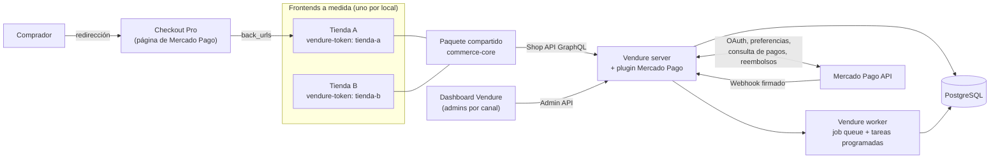
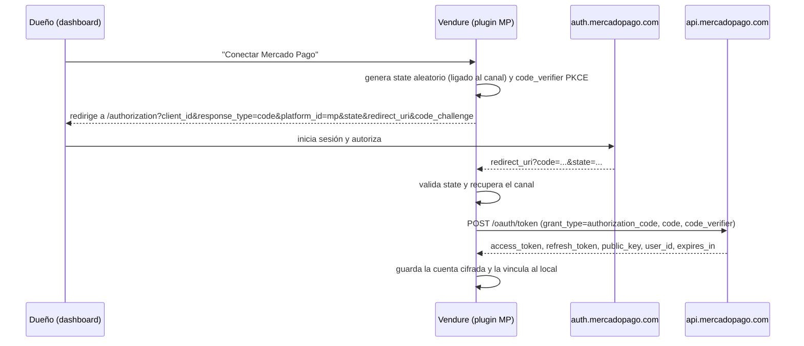
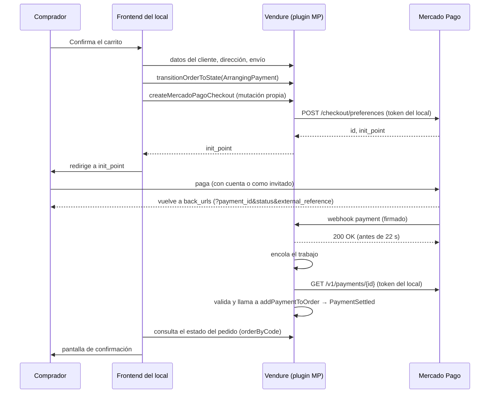

# Especificación técnica: servicio de tiendas virtuales para locales comerciales

| | |
|---|---|
| **Responsable** | Javier Debórtoli (proyecto personal) |
| **Versión** | 1.3 (MVP implementado, con cuentas y vínculos) |
| **Fecha** | 18 de octubre de 2026 |
| **Estado** | MVP implementado y probado con un Mercado Pago simulado. Quedan los puntos de la sección 13 que solo se pueden cerrar con credenciales reales de Mercado Pago |
| **Stack verificado** | TypeScript sobre Node.js 24 LTS, Vendure 3.8, PostgreSQL 17, Mercado Pago Argentina (Checkout Pro vía Preferences API) con el SDK `mercadopago` 3.x. Detalle en la sección 16 |

Convención usada en este documento:
- **[Doc]**: comportamiento confirmado en la documentación oficial (ver sección 17).
- **[Diseño]**: decisión propia de esta especificación, no viene de la documentación.
- **[Verificar]**: supuesto razonable que hay que confirmar en sandbox antes de salir a producción.
- **[Implementado]**: algo que se decidió o se descubrió al desarrollar y que este documento no preveía o preveía distinto. Cada marca remite a su entrada `DEC-n` en `DECISIONS.md` o a su punto `V<n>` en `VERIFICATION.md`, donde están el motivo y la evidencia.

**Versión 1.2**: el documento se actualizó para describir lo que se construyó. Los puntos de la sección 13 pasaron a tener estado, se agregaron los que aparecieron al implementar (V11 a V18) y se sumó la sección 18 con el estado de la implementación. Lo que no cambió sigue siendo el diseño original.

**Versión 1.3**: cada local dejó de tener una sola conexión. La cuenta de Mercado Pago (con sus tokens) y el vínculo con un local son entidades separadas, de modo que cambiar de cuenta o traspasarla no pierde reembolsos, pagos tardíos ni contracargos. Cambian las secciones 9.2 a 9.5, 9.7, 9.9, 12 y 18.2, y aparecen V19 y V20 en la sección 13.

---

## 1. Objetivo

Ofrecer a locales comerciales de Argentina tiendas online con **diseño a medida por cliente** (no plantillas parametrizables), sobre un **backend de comercio compartido y multi-tenant**, cobrando con **Mercado Pago** directamente en la cuenta de cada local.

El diferencial comercial es el frontend único por cliente. Todo lo demás (catálogo, pedidos, pagos, panel) es infraestructura común que se mantiene una sola vez.

## 2. Alcance

### Incluido en el MVP
- Backend Vendure único con un canal por local.
- Panel de administración por local (dashboard de Vendure con rol limitado a su canal).
- Frontend a medida por local, que consume un paquete compartido de lógica de comercio.
- Compra como invitado por defecto, con cuenta opcional compartida entre tiendas (sección 6).
- Pago con Mercado Pago Checkout Pro, cobrando en la cuenta del local (vinculada por OAuth).
- Reembolsos y cancelaciones desde el panel.
- Entrega por retiro en el local o envío con tarifa fija.
- Emails transaccionales con la marca del local y avisos de atención por problemas con Mercado Pago (secciones 6.3 y 9.4) [Implementado, DEC-35 y DEC-36].
- Tienda de referencia mínima y entorno Docker Compose completo (sección 16).

### Fuera del MVP
- Comisión por venta (split o `marketplace_fee`). El servicio se cobra con abono aparte.
- Pago embebido en el sitio (Checkout Bricks o Checkout API).
- Cotización automática con correos (Andreani, Correo Argentino, agregadores).
- Facturación electrónica de ARCA.
- Otras pasarelas (Ualá Bis, Payway), aunque la capa de pagos queda preparada para sumarlas.

## 3. Decisiones tomadas

| # | Decisión | Motivo |
|---|---|---|
| D1 | Backend: **Vendure**, una sola instancia con un **canal por local** | Los canales están pensados para multi-tenancy: cada uno tiene sus propios productos, métodos de envío y de pago [Doc] |
| D2 | **Frontend a medida por cliente** | Diferencial del servicio frente a los que usan una plantilla parametrizable |
| D3 | Lógica de carrito, checkout y pagos en un **paquete compartido** que usan todos los frontends | Un bug o un cambio de Mercado Pago se corrige una sola vez [Diseño] |
| D4 | **Mercado Pago Checkout Pro vía Preferences API** | Lo más simple de integrar, los datos de tarjeta no pasan por nuestro sistema, y la comisión de marketplace (para el futuro) está documentada para `/checkout/preferences` en Argentina [Doc] |
| D5 | Cada local cobra en **su propia cuenta**, vinculada por **OAuth** | Para operar en nombre de cada vendedor hay que usar su access token obtenido por OAuth [Doc]. No manejamos dinero de terceros |
| D6 | **Abono aparte** como modelo de cobro del servicio | Evita depender del split, que tiene restricciones dudosas en Argentina (sección 13) |
| D7 | Compradores: **invitado por defecto + cuenta opcional compartida** entre tiendas | Decisión de producto. Encaja con cómo Vendure modela los usuarios (sección 6) |
| D8 | Entrega: **retiro en el local** y **envío con tarifa fija** | Decisión de producto. Cubre a la mayoría de los locales chicos |
| D9 | Stack: **TypeScript estricto** sobre **Node.js 24 LTS**, monorepo con **npm workspaces**, **PostgreSQL 17**, empaquetado con **Docker** (sección 16) | Es el stack nativo de Vendure y del SDK de Mercado Pago. npm es el gestor que usan el instalador y las guías de Docker de Vendure, mientras que pnpm no figura en su documentación [Doc] |

## 4. Arquitectura



Componentes:
- **Vendure server**: expone la Shop API (tiendas) y la Admin API (gestión), ambas en GraphQL [Doc]. Incluye el plugin propio de Mercado Pago.
- **Vendure worker**: procesa la cola de trabajos (webhooks) y las tareas programadas (renovación de tokens) [Diseño, sobre funciones de Vendure].
- **PostgreSQL**: base oficialmente soportada junto con MySQL/MariaDB y SQLite [Doc].
- **Frontends**: uno por local, con cualquier framework. Hablan solo con la Shop API.
- **Stack tecnológico** de cada componente: sección 16.

## 5. Multi-tenancy

### 5.1 Un canal por local
- Cada local es un **Channel** con su **Seller** asignado [Doc]. El Seller se extiende con campos personalizados: logo, email de contacto y CUIT [Doc, Implementado].
- Configuración del canal: moneda por defecto **ARS**, idioma español y precios con IVA incluido [Diseño].
- El Channel tiene un campo propio, `mpStorefrontUrl` (**Storefront URL** en el dashboard): el origen público de la tienda del local. Solo lo edita el superadmin, no es público, y es el único origen aceptado para las URLs de retorno de Mercado Pago (sección 9.6) [Implementado, DEC-15].
- El frontend elige el canal enviando el encabezado `vendure-token` en cada llamada. La respuesta trae solo las entidades asignadas a ese canal [Doc].

### 5.2 Reglas sobre el canal por defecto
- El canal por defecto contiene **todas** las entidades, y un producto creado en un canal secundario **siempre queda asignado también al canal por defecto** [Doc].
- Por eso:
  - **Ningún frontend usa el token del canal por defecto.** Queda solo para el superadmin.
  - Como todos los canales usan ARS, el precio que se replica en el canal por defecto no genera inconsistencias de moneda [Diseño].
- [Implementado, DEC-23] Para que eso se cumpla, al arrancar el servidor alinea el canal por defecto con ARS, español, precios con IVA incluido y zona Argentina, y crea Argentina, su zona y el IVA del 21 % si faltan. Es idempotente.
- [Implementado, DEC-31] La tienda de referencia comprueba al iniciar que su token no sea el del canal por defecto y se niega a arrancar si lo es.

### 5.3 Administradores por local
- Cada local tiene un **Administrator** con un **Role limitado a su canal**. Un rol así no tiene visibilidad sobre otros canales ni sobre el canal por defecto [Doc].
- El superadmin (Javier) tiene el rol SuperAdmin, con acceso a todos los canales [Doc].
- [Implementado, DEC-22] **El rol del dueño no incluye `ReadSettings`, `ReadChannel` ni `ReadSeller`.** Las consultas `channels` y `sellers` de la Admin API no filtran por canal: con esos permisos un dueño vería nombre, CUIT, contacto y token de todos los demás locales (verificado con una prueba). El rol lleva solo los permisos que necesita: catálogo, pedidos, clientes, envíos, stock, zonas e impuestos de solo lectura y `ManageMercadoPago` (sección 9.3). El dashboard sabe cuál es el canal del usuario con `me { channels }` y `activeChannel`, que no piden permiso. Los datos del local (CUIT, contacto, logo) los edita el superadmin.

### 5.4 Alta de un local
Un script o mutación interna del superadmin crea, en una sola operación [Diseño, siguiendo el ejemplo oficial de multi-vendor [Doc]]:
1. Seller
2. Channel (token único, ARS, español)
3. Role limitado al canal y Administrator del dueño
4. StockLocation del local
5. ShippingMethods: retiro en el local y envío con tarifa fija (sección 8)
6. PaymentMethod con el handler `mercado-pago` asignado al canal

Después, el dueño entra al dashboard y conecta su cuenta de Mercado Pago (sección 9.2).

[Implementado, DEC-25] Cómo quedó:
- Es un servicio (`StoreProvisioningService`) que corre en **una sola transacción** con el contexto de un superadmin real (crear un rol exige que quien lo crea tenga esos permisos). Si falla cualquier paso, por ejemplo un email de administrador repetido, no queda nada. Primero crea las entidades y recién después las asigna al canal.
- Tiene tres entradas, todas con el mismo servicio: el script `npm run provision-store` (en contenedores, `docker compose run --rm provision-store`), la mutación `provisionStore` de la Admin API (solo superadmin) y `npm run seed-demo`, que da de alta los dos locales de demostración.
- Datos de entrada: nombre, código del canal (minúsculas, números y guiones), email y nombre del dueño, y opcionalmente `--token` (se genera si falta), `--owner-password` (se genera y se muestra **una sola vez**), `--storefront-url`, `--flat-rate` y `--flat-rate-minimum` (centavos de ARS, impuestos incluidos), `--contact-email`, `--cuit` y `--logo-url`.
- El PaymentMethod nace sin conexión: mientras el dueño no vincule su cuenta, la tienda no ofrece Mercado Pago.

### 5.5 Entidades que se separan por canal
Asset, Collection, Customer, Facet, FacetValue, Order, PaymentMethod, Product, ProductVariant, Promotion, Role, ShippingMethod y StockLocation [Doc].

## 6. Compradores (modelo híbrido)

### 6.1 Cómo lo modela Vendure
- **User** es la identidad (credenciales), única en todo el servidor. **Customer** y **Administrator** apuntan a un User [Doc].
- La **compra como invitado** está soportada: el Customer tiene email pero no User [Doc].
- Si un invitado se registra después con el mismo email, Vendure vincula el nuevo User con el Customer existente y conserva su historial [Doc].
- Por defecto, un cliente autenticado queda **asignado automáticamente** a cualquier canal en el que inicie sesión [Doc]. Desde la v3.7 eso se puede cambiar con `CustomerChannelAssignmentStrategy`, pero esa estrategia controla la pertenencia al canal, no el acceso a la API [Doc].

### 6.2 Comportamiento del MVP
- **Por defecto, la tienda funciona como invitado**: el checkout pide email, nombre y datos de entrega, sin crear cuenta.
- **Cuenta opcional**: el comprador puede registrarse. Esa cuenta **es la misma en todas las tiendas** de la plataforma.
- Se mantiene `DefaultCustomerChannelAssignmentStrategy`. Cuando el comprador inicia sesión en otra tienda, queda asignado a ese canal y ese local empieza a verlo como cliente [Doc].
- Los pedidos son por canal: un local no ve los pedidos que el comprador hizo en otra tienda [Doc, porque Order está separado por canal].
- [Implementado, V4] Si el email de la compra como invitado ya pertenece a una cuenta registrada y el comprador no inició sesión, Vendure responde `EMAIL_ADDRESS_CONFLICT_ERROR` y la tienda pide iniciar sesión. Se mantiene a propósito el valor por defecto (`allowGuestCheckoutForRegisteredCustomers: false`): permitir lo contrario deja que cualquiera cargue pedidos en la cuenta de otra persona con solo saber su email.
- [Implementado, V5] Un mismo email que compra como invitado en dos tiendas genera **un solo Customer**, asignado a los dos canales. Los dos locales ven el mismo cliente (nombre y email), aunque los pedidos siguen separados. Cualquier dato guardado en el Customer, como las direcciones de una cuenta registrada, es visible para todos los locales donde el comprador interactuó.

### 6.3 Consecuencias de producto [Diseño]
- La cuenta tiene que presentarse como **cuenta de la plataforma** (con un nombre de marca propio), no como "cuenta de la Tienda A". Si no, el comprador se va a sorprender cuando su contraseña funcione en otra tienda. [Implementado, DEC-30] El nombre se configura con `PLATFORM_NAME` (por defecto "la plataforma"), para no atar el proyecto a una marca.
- Los términos y la política de privacidad tienen que aclarar que la cuenta es compartida y que cada local ve los datos del comprador solo después de que este interactúe con su tienda. Por V5, hay que evitar guardar en el Customer datos que no deban compartirse entre locales.
- Los emails transaccionales (verificación, recuperación de contraseña) llevan la marca de la plataforma. Los de pedido llevan la marca del local. [Implementado, DEC-35 y V9] El remitente real es siempre la dirección de `EMAIL_FROM`: un local no puede enviar desde un dominio que no verificó, solo cambia el nombre que se muestra (saneado, sin comillas, ángulos ni saltos de línea). Los enlaces de los emails de cuenta apuntan a la tienda desde la que compró quien los recibe. Cada local puede reemplazar una plantilla con `apps/server/email-templates/stores/<código del canal>/<tipo>/<archivo>`; si no existe, se usa la de la plataforma y luego la de Vendure.

## 7. Catálogo, stock y promociones

Se usa lo que trae Vendure sin modificaciones: productos y variantes, campos personalizados, control de stock, búsqueda por facetas, colecciones y promociones, todo por canal [Doc].

Montos [Diseño]: Vendure guarda los importes como enteros en la unidad menor de la moneda (centavos). El `unit_price` de Mercado Pago es decimal, así que el plugin convierte con `importe / 100` al armar la preferencia. [Implementado] La conversión está en un módulo puro con pruebas, que cubre precios con centavos. El efecto del redondeo sobre el total que ve el comprador en Mercado Pago sigue en V7 (sección 13).

[Implementado, DEC-26] `HardenPlugin` rechaza con "Query is too complex" cualquier lista sin `take` explícito, así que `commerce-core` y la tienda de referencia siempre lo envían.

## 8. Entregas

Cada ShippingMethod combina un *checker* (si aplica al pedido) y un *calculator* (cuánto cuesta), y se puede restringir por zonas [Doc].

| Método | Checker | Calculator |
|---|---|---|
| Retiro en el local | Siempre elegible | Precio 0 |
| Envío con tarifa fija | Checker propio (`delivery-zone-eligibility-checker`): país del domicilio y monto mínimo opcional | Tarifa fija configurada por el local |

- El calculator de tarifa fija es el de Vendure por defecto. [Implementado, V8 y DEC-24] Resuelto: con `includesTax: include` e IVA 0, el precio con impuestos es exactamente la tarifa configurada para cualquier pedido (probado con carritos de 1, 3 y 7 unidades). La tarifa se carga en centavos de ARS, con impuestos incluidos.
- El checker propio es necesario porque Vendure no trae uno por zona. Se implementó como `ShippingEligibilityChecker` [Doc, por el mecanismo de extensión].
- [Implementado, V11] Si el envío deja de ser elegible, Vendure no devuelve error: lo reemplaza en silencio por el primero que califica (ver 9.6, paso 1).
- Más adelante, la cotización con correos se puede sumar como `ShippingCalculator` propio que llame a una API externa, sin tocar los frontends [Doc].

## 9. Pagos con Mercado Pago

### 9.1 Modelo
- Una sola **aplicación de Mercado Pago** registrada en la cuenta de vendedor de Javier (client_id, client_secret, clave secreta de webhooks).
- [Diseño] Antes de vincular al primer local, conviene decidir a nombre de quién queda esa aplicación. Si más adelante el proyecto pasa a una sociedad o a otra cuenta, una aplicación nueva tiene otro client_id, y cada local tendría que volver a autorizar por OAuth.
- Cada local vincula **su cuenta** a esa aplicación por OAuth. Los pagos se crean con el access token del local, así que el dinero va a su cuenta [Doc].
- Sin `marketplace_fee` en el MVP (D6).

### 9.2 Vinculación OAuth (flujo authorization code)



Requisitos confirmados [Doc]:
- La `redirect_uri` tiene que ser **estática** y coincidir exactamente con la configurada en la aplicación. Cualquier dato extra (como el canal) viaja en `state`.
- El `code` recibido es válido por **10 minutos**, así que el canje se hace en el momento.
- El **access token dura 180 días**.
- PKCE es opcional pero recomendado. Se habilita en los detalles de la aplicación y usa `code_challenge` y `code_challenge_method` (S256).
- Para sandbox, el canje acepta `test_token: true`.

Decisión [Diseño]: se usa PKCE con S256, y el `state` se guarda en el servidor con un vencimiento corto y un solo uso.

[Implementado] Cómo quedó:
- **OAuth con `fetch`, no con el SDK** (DEC-10): el cliente `OAuth` del SDK 3.6.1 no soporta `code_verifier`, `code_challenge`, `grant_type` ni `test_token` en sus tipos. El SDK se usa para preferencias, pagos, reembolsos, cancelaciones y firma.
- **Rutas**: el dueño inicia la vinculación con la mutación `startMercadoPagoConnection` (Admin API), que devuelve la URL de autorización; Mercado Pago vuelve a `GET /mercadopago/oauth/callback` (la `redirect_uri` registrada en la aplicación, `MP_REDIRECT_URI`). Al terminar, el dueño vuelve a `/dashboard/mercado-pago?mp=connected|error` (`MP_DASHBOARD_URL`). El `client_secret` nunca va en la URL de autorización.
- **Sandbox**: `MP_OAUTH_TEST_TOKEN=true` agrega `test_token: true` al canje. Con credenciales reales se pone en `false`.
- **Permiso sin conexión**: la vinculación se rechaza si el `scope` devuelto no incluye `offline_access`, porque esa conexión no se podría renovar. Si Mercado Pago no devolviera `scope` aunque el permiso esté otorgado, `MP_REQUIRE_OFFLINE_ACCESS=false` lo relaja (V17).
- **Una cuenta vende para un solo local a la vez**: se aplica con índices únicos *parciales* en la base sobre los vínculos `active` (9.3). Los vínculos `retired` y `released` no bloquean nada. **Una cuenta revocada (`disconnected`) que sigue `active` en un local tampoco la puede tomar otro**: ese local tiene que desvincularla o el superadmin retirarla (DEC-42). Esto corrige lo que decía la versión anterior, "una conexión `disconnected` no bloquea: otro local puede tomar esa cuenta", que el índice único sobre `mpUserId` nunca permitió.
- La respuesta del renovado y de `mp-connect` no está bien documentada; el comportamiento adoptado está en 9.4 (DEC-11, DEC-16).

Regla [Diseño]: **una cuenta de Mercado Pago vende para un solo local a la vez.** Los pagos se atribuyen al local por el pedido (9.7), no por la cuenta, pero si dos locales vendieran con la misma cuenta, los reembolsos, las cancelaciones y los avisos de la cuenta no tendrían un local claro. Por eso `mpUserId` es único en la base (9.3) y un local tiene como máximo un vínculo `active`.

Con el `user_id` X que devuelve el OAuth para el local C [Implementado, DEC-41]:

| Situación | Resultado |
|---|---|
| X está `active` en **otro** local | Se rechaza con un mensaje claro y no se cambia nada |
| C ya tiene a X `active` | Reconexión: se actualizan los tokens de la cuenta |
| C tiene otra cuenta Y `active` | El vínculo C–Y pasa a `retired` (`retiredAt` = ahora) y queda C–X `active` |
| C tiene un vínculo `retired` con X | Se reactiva ese vínculo, sin crear otro |
| X tiene vínculos `retired` en otros locales | Se permite: se crea C–X `active` y los otros siguen `retired` |

- En todos los casos los tokens nuevos reemplazan los de la cuenta X. **Nunca se copian tokens de un local a otro**: un traspaso siempre exige que el titular autorice por OAuth en el local nuevo.
- Un dueño con dos locales necesita una cuenta de Mercado Pago distinta para cada uno.
- [Implementado] **Cambiar de cuenta**: el local vincula Y y X queda `retired`. Sus ventas se siguen pudiendo reembolsar, sus pagos pendientes (un cupón de Rapipago, una preferencia ya creada) se siguen liquidando y sus contracargos se siguen asignando al local.
- [Implementado] **Traspasar una cuenta de A a B**: A la desvincula (queda `retired`) y después B la autoriza por OAuth. Las ventas de A siguen siendo de A y las de B, de B, aunque la cuenta sea la misma.
- [Verificar] V20: si una autorización nueva de la misma cuenta anula los tokens anteriores. El diseño funciona igual en los dos casos, porque los tokens viven una sola vez en la cuenta y la autorización nueva reemplaza los guardados.

### 9.3 Almacenamiento de credenciales [Diseño]
Las credenciales **no** se guardan en los argumentos del PaymentMethod, porque vencen y se rotan. Se usan dos entidades propias del plugin [Implementado, DEC-41]: la cuenta, que guarda los tokens una sola vez, y el vínculo, que dice qué local usa o usó esa cuenta.

**`MercadoPagoAccount`**: una fila por cuenta de Mercado Pago, sin importar cuántos locales la hayan usado.

| Campo | Notas |
|---|---|
| `mpUserId` | **Único.** Sirve para identificar la cuenta cuando llega un webhook |
| `accessToken` | Cifrado (AES-256-GCM, clave en variable de entorno). Vacío si la cuenta está `disconnected` o `released` |
| `refreshToken` | Cifrado. Igual |
| `publicKey` | |
| `expiresAt` | Calculado a partir de `expires_in` |
| `scope` | Tiene que incluir `offline_access` |
| `status` | `connected`, `expiring`, `disconnected`, `released` |

**`MercadoPagoChannelLink`**: el vínculo entre un local y una cuenta.

| Campo | Notas |
|---|---|
| `channelId` | El local |
| `accountId` | La cuenta |
| `status` | `active`, `retired`, `released` |
| `linkedAt`, `retiredAt`, `releasedAt` | Cuándo se vinculó, se retiró y se liberó |

Reglas, aplicadas con **índices únicos parciales** en la base y no solo en el código:
- Un local tiene como máximo **un vínculo `active`** (índice único sobre `channelId` donde `status = 'active'`).
- Una cuenta está **`active` en un solo local** a la vez (índice único sobre `accountId` donde `status = 'active'`).
- Los vínculos `retired` y `released` **no bloquean** nada.

[Implementado] Detalles:
- El cifrado usa AES-256-GCM con un contexto de datos autenticados (AAD) que liga cada token **a la cuenta** y al campo (`mp-account:<mpUserId>:access` y `:refresh`), de modo que un token copiado a la fila de otra cuenta no se descifra. Antes se ligaba al canal, y por eso un cambio de local obligaba a volver a cifrar. La clave es `MP_TOKEN_ENCRYPTION_KEY` (`openssl rand -base64 32`). **Si se pierde, hay que volver a vincular todos los locales**, y rotarla tampoco es automático.
- Los tokens no salen de la cuenta: ninguna operación de la API los devuelve. El dashboard consulta `mercadoPagoConnection` y `mercadoPagoPreviousAccounts` y solo recibe estado, cuenta y fechas.
- `expiring` es un subestado de "conectada": la última renovación falló, el token todavía sirve y el dueño tiene que volver a vincular. Para que la cuenta sirva, el estado tiene que ser `connected` o `expiring` y el token no puede haber vencido.
- Ciclo de vida de un vínculo: `active` pasa a `retired` cuando el local desvincula, cuando cambia de cuenta o cuando el superadmin la retira; `retired` pasa a `released` cuando ya no hay nada que reembolsar (9.4). Volver a vincular la misma cuenta al mismo local reactiva el vínculo, sea `retired` o `released`, y no crea otro.
- Permiso `ManageMercadoPago`: lo tienen el dueño de cada local y el superadmin, y protege `mercadoPagoConnection`, `mercadoPagoPreviousAccounts`, `startMercadoPagoConnection` y `disconnectMercadoPago`. Las herramientas del superadmin (`retireMercadoPagoAccount`, `mercadoPagoChannelLinks`, `mercadoPagoReleasePreview`, `releaseMercadoPagoLink`) piden `SuperAdmin`. `cancelMercadoPagoPayment` pide `UpdateOrder` (sección 9.9).
- Además de la cuenta y el vínculo, el plugin tiene dos entidades más: `MercadoPagoOAuthState` (el `state` de un solo uso, ligado al canal, con el `code_verifier` cifrado) y `MercadoPagoPaymentClaim` (el reclamo por pago que garantiza la idempotencia, sección 9.7). Todas con migración.
- **Migración desde la versión anterior** (una conexión por local): cada conexión pasa a ser una cuenta y un vínculo `active`, conservando los tokens, que se vuelven a cifrar para la cuenta (por eso la migración necesita `MP_TOKEN_ENCRYPTION_KEY` si hay tokens guardados, y falla sin tocar nada si falta). Los pagos ya cobrados reciben `mpAccountUserId` con la cuenta de su local, la única que existía. Se puede revertir. Está probada sobre una base con datos de la versión anterior.
- Cada pago cobrado guarda en su `metadata` dos datos por separado: `mpAccountUserId` (el `mpUserId` de la cuenta **con cuyo token se consultó el pago**, la que se usa para reembolsarlo y cancelarlo) y `mpCollectorId` (el `collector_id` tal como lo devuelve Mercado Pago). Ver 9.5 y V19.

### 9.4 Renovación de tokens
- La renovación usa `grant_type=refresh_token` y devuelve un access token nuevo **y un refresh token nuevo, que hay que volver a guardar** [Doc].
- Solo funciona si la aplicación recibió el scope `offline_access` y el vendedor lo autorizó [Doc].
- [Diseño] Una tarea programada diaria en el worker renueva las cuentas que venzan en menos de 30 días. Si falla, marca la cuenta como `expiring` y avisa al local y al superadmin para que vuelva a conectar.
- [Diseño] Se escucha el tópico `mp-connect` (vinculación y desvinculación de cuentas OAuth) [Doc] para marcar `disconnected` si el titular revoca el acceso. Mientras esté desconectada, el método de pago queda no elegible en cada canal que la use.
- [Implementado] Cómo quedó:
  - La tarea corre con el planificador por defecto de Vendure (una sola ejecución aunque haya varios workers). La ventana de 30 días es configurable en el plugin (`refreshWindowDays`). Renueva **cada cuenta que algún local todavía use o pueda reembolsar con ella** (con al menos un vínculo `active` o `retired`); una cuenta que solo tiene vínculos `released` no se renueva. `npm run refresh-connections` (en contenedores, `docker compose run --rm refresh-connections`) renueva a pedido, y con `--all` fuerza todas.
  - Renovar es una operación serializada **por cuenta, no por local** (DEC-49): dos locales pueden compartir una cuenta (uno `retired` y otro `active`), y dos renovaciones simultáneas no gastan el mismo `refresh_token`, que al rotar quedaría inválido. Se guarda el `refresh_token` nuevo; si la respuesta no trae `expires_in`, se asumen 180 días, la vigencia documentada (DEC-11, V12). La serialización es dentro de un proceso, como antes; entre el servidor y el worker no hay un candado.
  - `mp-connect` (DEC-16): la documentación no describe el cuerpo de esa notificación. Al recibirla, el plugin **no confía en el cuerpo**: pregunta a Mercado Pago (`GET /users/me` con el token del local, y renueva si falla) y marca `disconnected` solo si el acceso de verdad fue revocado. Es la misma regla que para los pagos (V13).
  - Avisos (DEC-36, DEC-50): el plugin solo publica `MercadoPagoAttentionEvent`; el servidor envía el email. Va a los administradores del canal siempre y, para los problemas que también conciernen a la plataforma (`token_renewal_failed`, `account_disconnected`, `collector_mismatch`, `collector_missing`, `released_link_payment`, `unverifiable_payment`), además en copia oculta al superadmin y a `PLATFORM_ALERT_EMAIL` si está definida (el usuario superadmin por defecto no es una dirección de email). Si el local no tiene administradores con email, el aviso va a la plataforma. Un aviso sobre una cuenta que ningún local usa (`unverifiable_payment`) no tiene local y va solo a la plataforma. `link_released` es informativo y va solo al local. Los pagos que quedan para revisión manual (9.8) también generan aviso. Una renovación o una revocación que afecta a una cuenta avisa a cada local que la usa o puede reembolsar con ella.
  - **Desvincular no borra nada** (DEC-45): "Desvincular" pasa el vínculo `active` a `retired`. El local deja de ofrecer Mercado Pago, pero sus ventas siguen pudiendo reembolsarse y sus pagos pendientes se siguen procesando. Mientras tanto, el verificador de elegibilidad oculta el método a los compradores nuevos, pero un pago que Mercado Pago ya aprobó se aplica a su pedido igual: el procesador abre un alcance de liquidación (`settlement-scope.ts`) solo después de verificar el pago, para que el verificador no lo rechace.
  - **Liberación automática** (DEC-47): una tarea diaria (`mercadopago-release-links`, después de la renovación) pasa un vínculo `retired` a `released` cuando se cumplen **las dos** condiciones: pasaron **180 días** desde el último pago liquidado de ese vínculo (mismo local y misma cuenta; es el plazo en que Mercado Pago permite reembolsar) y **30 días** desde `retiredAt` (ya no se crean preferencias con ese vínculo y los pagos sin confirmar vencen solos a los 30 días). Un vínculo que nunca liquidó un pago solo espera los 30 días. Ambas ventanas son configurables en el plugin (`releaseAfterLastPaymentDays` y `releaseAfterRetiredDays`, variables `MP_RELEASE_AFTER_LAST_PAYMENT_DAYS` y `MP_RELEASE_AFTER_RETIRED_DAYS`). Al liberar se registra `releasedAt`, se avisa a los administradores del local, y si la cuenta ya no tiene vínculos `active` ni `retired` se borran sus tokens y queda `released`. `npm run release-links` corre lo mismo a pedido, y con `--dry-run` solo lista lo que liberaría.
  - **Herramientas del superadmin** (DEC-47): `retireMercadoPagoAccount(channelId)` retira la cuenta de un local cerrado cuyo dueño ya no está. `mercadoPagoReleasePreview(linkId)` dice cuántos pagos de ese vínculo todavía se podrían reembolsar (los liquidados dentro de los últimos 180 días, sin descontar los ya reembolsados) y `releaseMercadoPagoLink({ linkId, confirm: true })` libera un vínculo `retired` ya, sin esperar los plazos: exige la confirmación explícita y sirve, por ejemplo, si el titular de una cuenta pide que se borre su acceso. Un vínculo `active` no se puede liberar: primero hay que retirarlo.
  - **Qué muestra el dashboard** (Ajustes › Mercado Pago): la cuenta activa, y una lista de cuentas anteriores con su estado y la fecha estimada de liberación. Antes de "Vincular otra cuenta" y de "Desvincular" se muestra: "No revoques el acceso de esta cuenta desde Mercado Pago durante 180 días. Si lo hacés, los reembolsos de las ventas cobradas en ella vas a tener que hacerlos desde el panel de Mercado Pago." Ninguna operación devuelve tokens.

### 9.5 Handler de pago en Vendure
Vendure trae solo un handler de prueba, y cada integración se escribe como un `PaymentMethodHandler` [Doc]. Funciones del handler `mercado-pago`:

| Función | Uso en esta integración |
|---|---|
| `createPayment` | Se llama desde el procesamiento del webhook o de `syncMercadoPagoPayment` (no desde el frontend) cuando el pago ya está aprobado. Vuelve a consultar el pago a Mercado Pago y exige las mismas condiciones (ver abajo). Devuelve `state: 'Settled'`, `transactionId` = id del pago en Mercado Pago, y `amount` |
| `settlePayment` | Devuelve `{ success: true }`, porque el pago llega ya capturado. Así está documentado para las integraciones que capturan al crear [Doc] |
| `cancelPayment` | Opcional [Doc]. Cancela pagos `pending` o `in_process` en Mercado Pago, con el token de la cuenta que cobró el pago |
| `createRefund` | Opcional [Doc]. Llama a `POST /v1/payments/{id}/refunds` con el token de la **cuenta que cobró el pago** (`metadata.mpAccountUserId`), no con el de la cuenta con la que el local vende hoy |

Es el patrón de **página de pago alojada** que describe Vendure: el pago ya está autorizado cuando vuelve la notificación, la validación ocurre en un controlador o servicio, y el handler solo registra los datos [Doc]. El plugin oficial de Mollie usa la misma forma: una mutación que crea el "intent" y devuelve la URL, la redirección y el webhook que actualiza el pedido [Doc].

[Implementado] Diferencias y precisiones respecto del diseño original:
- **El handler vuelve a verificar el pago** (DEC-13). `addPaymentToOrder` es una mutación **pública** de la Shop API: sin esta verificación, cualquier comprador podría llamarla con un `mpPaymentId` inventado. Por eso `createPayment` consulta el pago a Mercado Pago con el token de una cuenta que el local usó (primero la `active`, después las `retired` y, solo para pagos ya verificados, las `released` que todavía tengan tokens) y exige estado `approved`, `collector_id` igual a esa cuenta (más abajo), `external_reference` igual al código del pedido, moneda ARS y monto exacto. Sin un pago aprobado real de ese pedido no hay forma de liquidarlo desde el frontend. El costo es una segunda consulta por cada pago aprobado.
- **`createRefund`** (DEC-17, DEC-46): si Mercado Pago rechaza el reembolso (por ejemplo, por falta de saldo), devuelve `state: 'Failed'` con `metadata.errorMessage` con el motivo de Mercado Pago, en lugar de lanzar una excepción. Así el intento queda registrado en el pedido. Si la cuenta que cobró el pago ya no puede operar (está `released` o `disconnected`, o el local ya no tiene un vínculo `active` ni `retired` con ella), el reembolso queda `Failed` con: "Este pago se cobró en la cuenta <identificador>, que ya no está vinculada. Hacé el reembolso desde el panel de Mercado Pago de esa cuenta." Nunca se usa el token de una cuenta que otro local usa hoy para operar sobre las ventas de este.
- **Cada pago registra quién lo cobró** (DEC-44): al liquidarlo, el handler guarda en `metadata` `mpAccountUserId` (la cuenta con cuyo token se consultó) y `mpCollectorId` (el `collector_id` que devuelve Mercado Pago). Un pago anterior a este cambio sin `mpAccountUserId` se asume de la cuenta `active` del local; la migración lo completa.
- **El `collector_id` tiene que ser la cuenta consultada** (DEC-44, V19), en el webhook, en `syncMercadoPagoPayment` y en `createPayment`. Si Mercado Pago devuelve un `collector_id` presente e igual al `mpUserId` de la cuenta consultada, siguen las validaciones normales. Si es **distinto** o **falta**, el pago **no se liquida**: el reclamo queda en `needs_review` con el motivo `collector_mismatch` o `collector_missing`, el pedido recibe una nota y se avisa al local y a la plataforma. Nunca se acepta en silencio. Esta comparación no es solo para saber a qué local va el pago: también impide liquidar un pedido con un pago aprobado de **otra** cuenta cuyo `external_reference` se haya falsificado, en caso de que el token de un local pudiera leer pagos ajenos. No hay una variable para desactivarla. Si hay varias cuentas candidatas se prueba cada una y se acepta la primera cuyo pago traiga el `collector_id` correcto; la regla solo frena la liquidación: un pago de otro estado (pendiente, rechazado, devuelto o contracargado) se registra como siempre aunque tenga ese problema, para no perder el aviso de un contracargo, y el log deja el `collector_id` observado. Que `collector_id` coincida con el `user_id` del OAuth está sin confirmar: es lo primero que hay que probar en sandbox (V19) y, si no coincide, la regla se rediseña.
- **`cancelPayment`** está implementado, pero Vendure solo lo ofrece para pagos que conoce, y este plugin nunca registra pagos pendientes (9.8). Por eso existe además la mutación `cancelMercadoPagoPayment` (9.9).
- **Elegibilidad**: un `PaymentMethodEligibilityChecker` propio (`mercado-pago-connected`) hace elegible el método solo si el canal tiene un vínculo `active` con una cuenta no revocada y con el token vigente (sección 9.4). Un pago que Mercado Pago ya aprobó se liquida igual aunque el local ya no ofrezca el método (alcance de liquidación, 9.4).
- **Leer el propio pedido durante el pago** (DEC-27): con la estrategia por defecto de Vendure, un invitado solo puede leer un pedido por código **después** de colocado, no mientras está en `ArrangingPayment`, y la pantalla de resultado no podría consultar el estado. El plugin envuelve la estrategia configurada (`SessionOrderByCodeAccessStrategy`) y permite además leer el pedido activo de la propia sesión. Otra sesión sigue sin poder leerlo.

### 9.6 Flujo de compra (Checkout Pro)



Detalle de cada paso:

1. **Preparación**: el frontend completa cliente, dirección y método de envío, y pasa el pedido a `ArrangingPayment`, el estado en el que se consultan los métodos de pago elegibles [Doc]. Desde Vendure 3.8, al pasar a `ArrangingPayment` el pedido se recalcula y se vuelve a comprobar que el método de envío siga siendo elegible [Doc, notas de la versión 3.8.0]. El frontend tiene que manejar el error si el envío deja de ser elegible en ese punto. [Implementado, V11 y DEC-39] **La API no devuelve ningún error**: Vendure 3.8 reemplaza el envío que dejó de calificar por el primero que sí califica en el momento en que cambia el pedido (por ejemplo, al bajar la cantidad por debajo del mínimo del envío a domicilio queda "Retiro en el local", sin costo de envío), y el pase a `ArrangingPayment` funciona. El riesgo es que, con dos pestañas abiertas, el comprador pague un total distinto del que revisó. Por eso `commerce-core` ofrece `startPayment(urls, { expectedTotal })`: falla con `ORDER_CHANGED` y no crea la preferencia si el pedido ya no suma lo que el comprador vio. La tienda de referencia envía el total de la pantalla de pago.
2. **Creación de la preferencia** (mutación propia de la Shop API, `createMercadoPagoCheckout`) [Diseño]:
   - Entrada: `orderCode`, `successUrl`, `failureUrl` y `pendingUrl`. Devuelve `preferenceId`, `initPoint`, `sandboxInitPoint` y `expiresAt`, o un `MercadoPagoError` (con `ErrorCode` extendido, DEC-21).
   - `items`: líneas del pedido con `currency_id: "ARS"`, más una línea de envío (`MP_PREFERENCE_ITEMS_MODE=lines`, el valor por defecto). Si las líneas no suman exactamente el total del pedido, el plugin cae solo a una sola línea con el total y el código del pedido. `MP_PREFERENCE_ITEMS_MODE=total` fuerza ese modo. [Implementado] Cuál queda como valor por defecto se decide con V7 (sección 13).
   - `external_reference`: el `code` del pedido de Vendure.
   - `back_urls` con `success`, `failure` y `pending` apuntando a la página de resultado del frontend del local, y `auto_return: "approved"`. Mercado Pago redirige solo cuando el pago se aprueba, con una demora de hasta 40 segundos que no se puede cambiar [Doc]. Las `back_urls` no pueden ser dominios locales como `localhost` [Doc]. [Implementado, DEC-15] El servidor las valida contra el `mpStorefrontUrl` del canal: tienen que ser https, no locales y del mismo origen. Así un comprador nunca es enviado a un dominio que el local no configuró. `MP_ALLOW_INSECURE_RETURN_URLS=true` acepta URLs http o locales del origen configurado y existe solo para pruebas y demos locales (DEC-32); por defecto está apagada.
   - Vigencia de la preferencia acotada (por ejemplo 30 minutos), para que no se pueda pagar un carrito viejo [Diseño, la opción existe [Doc]]. [Implementado, DEC-19] Es `MP_PREFERENCE_TTL_MINUTES` (30 por defecto). La clave de idempotencia es un hash de canal, pedido, total, URLs y una ventana de 5 minutos, y `expiration_date_from` y `expiration_date_to` se calculan desde el inicio de esa misma ventana, para que repetir la llamada dentro de ella envíe un cuerpo idéntico. Efecto: la vigencia real es de entre 25 y 30 minutos. Que Mercado Pago acepte un `expiration_date_from` unos minutos en el pasado está por confirmar (V14).
   - **Sin `notification_url`** en el modo por defecto: ver 9.7.
   - Clave de idempotencia en la creación (el SDK acepta `idempotencyKey`) [Doc].
   - Devuelve `init_point`.
3. **Pago**: el comprador paga en Mercado Pago, con su cuenta o como invitado [Doc].
4. **Regreso**: Mercado Pago vuelve a la `back_url` con `payment_id`, `status`, `external_reference` y `merchant_order_id` [Doc]. **El frontend nunca da el pago por confirmado con estos parámetros**: solo muestra "procesando" y consulta el estado del pedido [Diseño]. [Implementado, DEC-28 y DEC-31] La pantalla de resultado de la tienda de referencia **no lee `status` de la URL**: toma `payment_id` (o `collection_id`) y `external_reference` solo como punteros. Una prueba E2E cubre el caso "la URL dice aprobado pero el pago está pendiente". Qué parámetros trae de verdad la redirección está por registrar (V16).
5. **Confirmación por webhook**: sección 9.7.
6. **Respaldo si el webhook se demora** [Diseño]: si a los ~10 segundos el pedido sigue sin pago, el frontend llama a `syncMercadoPagoPayment(orderCode, paymentId)` con el `payment_id` recibido en la redirección. El servidor consulta ese pago con el token del local y aplica las mismas validaciones del webhook. Es el mismo enfoque del plugin de Mollie, que ofrece una mutación de sincronización forzada para cuando el webhook se atrasa [Doc].
   - [Implementado] La espera es configurable en la tienda de referencia (`PAYMENT_SYNC_AFTER_MS`, 10000 por defecto). El estado lo consulta una ruta propia de la tienda (`/api/payment-status`), no el navegador contra Vendure.
   - [Implementado, DEC-20] `syncMercadoPagoPayment` **no exige la sesión del comprador**: el comprador a veces vuelve de Mercado Pago sin su sesión original. La mutación solo recibe un puntero (`paymentId`) y aplica las mismas reglas que el webhook (consulta con el token del local, referencia, moneda y monto exactos, idempotencia). Sin un pago aprobado real de ese pedido no puede cambiar nada, y devuelve únicamente `outcome`, `orderCode` y `orderState` del pedido cuyo código ya conoce quien llama. Los resultados posibles son `settled`, `already_settled`, `pending`, `rejected`, `cancelled`, `reversed`, `unknown` y `needs_review`.
   - [Implementado] `commerce-core.payment.waitForPayment({ orderCode, paymentId })` encapsula la espera, el respaldo y la consulta del estado, y devuelve `paid`, `pending`, `failed`, `review` o `processing`. Nunca acepta el estado de la redirección como dato.

### 9.7 Webhooks

**Configuración**: a nivel aplicación, en "Tus integraciones", con el evento **Payments** (tópico `payment`) y el tópico `mp-connect`. Esta configuración genera una clave secreta para validar la firma [Doc].

¿Por qué no `notification_url` por preferencia? [Diseño]
- La URL definida en la preferencia tiene prioridad sobre la de la aplicación [Doc].
- La documentación asocia la validación con clave secreta a la configuración en "Tus integraciones" y no aclara si las notificaciones a `notification_url` vienen firmadas.
- La cuenta se identifica con el campo `user_id` de la notificación, que Mercado Pago describe como identificador del vendedor [Doc], buscando la cuenta con ese `mpUserId`. [Implementado] **El local no se deduce de la cuenta sino del pedido** (DEC-43): una cuenta puede haber vendido para varios locales a lo largo del tiempo.
- Ver [Verificar] V1 y V2 en la sección 13. Si V1 falla, el plan B es usar `notification_url` con el canal en la ruta y apoyarse en la consulta al pago, que es la verificación de fondo de todas formas.

[Implementado] Los dos modos están construidos y se eligen con `MP_WEBHOOK_MODE`:
- **`application`** (por defecto, diseño principal): la preferencia no lleva `notification_url`. Mercado Pago llama a `POST /mercadopago/webhook`, la URL configurada en la aplicación, y la cuenta se identifica por `user_id`.
- **`preference`** (plan B): cada preferencia lleva su `notification_url` con el token del canal en la ruta, `POST /mercadopago/webhook/:channelToken`. Con `MP_REQUIRE_SIGNATURE_IN_PREFERENCE_MODE=true` (por defecto) se exige la firma; si V2 muestra que esas notificaciones vienen sin firma, se pone en `false` y el sistema sigue siendo seguro, porque la verdad es siempre la consulta del pago con el token del local (en ese modo cualquiera puede *provocar* una consulta, pero no cambiar el resultado). Los pasos para decidir están en `VERIFICATION.md` (V1 y V2).

**Procesamiento**:
1. **Validar la firma** del encabezado `x-signature` (`ts=…,v1=…`) [Doc]:
   - Manifest: `id:{data.id};request-id:{x-request-id};ts:{ts};`, omitiendo los pares cuyos valores no vengan [Doc].
   - `data.id` en minúsculas si es alfanumérico [Doc].
   - HMAC-SHA256 en hexadecimal con la clave secreta, comparado en tiempo constante con `v1` [Doc].
   - Además [Diseño]: rechazar si `ts` está fuera de una ventana de tolerancia.
   - [Implementado, DEC-9, V3 y V18] Se usa `WebhookSignatureValidator` del SDK 3.6.1, envuelto en `src/lib/signature.ts`. Dos diferencias con la documentación, cubiertas con pruebas: el SDK no pasa `data.id` a minúsculas (el plugin lo hace antes de llamarlo) y trata `ts` como segundos, aunque la documentación dice milisegundos. El plugin acepta las dos unidades en la ventana de tolerancia (`MP_WEBHOOK_TOLERANCE_SECONDS`). Con qué unidad llega en la práctica está por registrar (V18).
2. **Responder 200** enseguida. Mercado Pago espera la confirmación hasta **22 segundos** y si no la recibe reintenta, cada 15 minutos al principio y con intervalos crecientes después [Doc].
3. **Encolar** el procesamiento en la job queue de Vendure [Diseño].
4. En el worker:
   - Buscar la cuenta por `user_id`. Si no existe o no tiene tokens, descartar, registrar y avisar a la plataforma.
   - **Consultar el pago** con `GET /v1/payments/{id}` usando el token de esa cuenta, que es lo que indica Mercado Pago después de recibir la notificación [Doc]. **La notificación nunca es la fuente de verdad** [Diseño].
   - Buscar el pedido por `external_reference` **en todo el servidor** (el código del pedido es único en toda la base, no solo dentro de un canal) y tomar su canal.
   - Exigir que ese canal tenga o haya tenido un vínculo (`active` o `retired`) con la cuenta. Si no, el resultado es `ignored` y se registra.
   - Exigir que el `collector_id` del pago sea la cuenta consultada (9.5).
   - Validar que el monto sea igual al `totalWithTax` del pedido y la moneda ARS.
   - Aplicar la tabla de estados (9.8).
   - **Idempotencia**: si ya existe un Payment con ese `transactionId`, no hacer nada. Las notificaciones pueden repetirse [Diseño].

[Implementado] Precisiones del procesamiento:
- **Respuesta y cola**: el controlador valida la firma, responde 200 de inmediato y encola el trabajo en la job queue de Vendure con reintentos y espera exponencial. Cada notificación aceptada deja una línea de log (`Webhook received: topic=… id=… user_id=… signed=…`) y su resultado (`Payment …: settled|pending|…`), sin tokens (DEC-40). Una firma inválida se rechaza con 401.
- **Idempotencia con dos mecanismos** (DEC-14), porque la comprobación "ya existe un Payment" no alcanza ante notificaciones concurrentes:
  - Tabla de reclamos `MercadoPagoPaymentClaim`, con índice único por `mpPaymentId` y estados `recorded`, `processing`, `settled` y `needs_review`. Solo quien gana el reclamo agrega el pago; un reclamo `processing` abandonado se retoma a los 5 minutos.
  - En PostgreSQL, cada liquidación toma un `pg_advisory_xact_lock` sobre el pedido. Sin él, **dos pagos aprobados distintos para un mismo pedido se liquidaban los dos** (verificado quitando el bloqueo en `e2e/concurrency.e2e-spec.ts`). El segundo queda en `needs_review` y se avisa al local, que decide si reembolsa.
- **Asignación por pedido** (DEC-43). Modo `application`: la cuenta sale de `user_id`, el pedido de `external_reference` en todo el servidor, y el local es el canal de ese pedido. Modo `preference`: la ruta trae el token del canal; se prueban las cuentas de los vínculos `active` y `retired` de ese canal (solo la que nombra `user_id`, si viene) y además el pedido tiene que pertenecer al canal de la ruta: una notificación cuyo pedido es de otro canal se ignora. `syncMercadoPagoPayment`: las cuentas candidatas son las de los vínculos `active` y `retired` del canal del pedido. Así un contracargo de un local que ya no vende con una cuenta se asigna a ese local, y los pagos de un traspaso van al local de su pedido.
- **Vínculo `released`**: si llega un pago aprobado para un vínculo `released` y la cuenta todavía tiene tokens (porque está `active` en otro local), se verifica y se procesa normalmente, y además se avisa a la plataforma (`released_link_payment`): indica que la regla de liberación falló. Si la cuenta no tiene tokens, el pago no se puede verificar: se avisa a la plataforma (`unverifiable_payment`) y no se descarta en silencio.
- **Pago inexistente o ajeno**: si no hay cuenta para el `user_id`, el pedido no existe en ningún local, o el local nunca usó esa cuenta, el resultado es `ignored` y se registra. El resto de las validaciones (estado, referencia, moneda, monto exacto, reclamo, bloqueo por pedido, idempotencia) no cambió.

### 9.8 Correspondencia de estados [Diseño]

| Estado del pago en MP | Acción en Vendure |
|---|---|
| `approved` | `addPaymentToOrder` con `metadata.mpPaymentId`. El handler devuelve `Settled` y el pedido pasa a `PaymentSettled` [Doc, el pedido pasa a ese estado cuando el pago cubre el total] |
| `pending` / `in_process` | No se agrega el pago. Se registra en el historial y el frontend muestra "pago pendiente". Es el caso de Rapipago y Pago Fácil, que redirigen a la `back_url` de pendiente hasta que se pague en el local físico [Doc] |
| `authorized` | Se trata como `pending`: significa "a la espera de captura" y Checkout Pro captura al aprobar, así que no se espera [Implementado] |
| `rejected` | No se agrega el pago. El pedido sigue en `ArrangingPayment` y el comprador puede reintentar |
| `cancelled` / expirado | Igual que `rejected`. Los pagos sin confirmar vencen solos a los 30 días [Doc] |
| `refunded` / `charged_back` / `in_mediation` | Registrar y avisar al local. No se cambian estados de forma automática en el MVP. `in_mediation` se agregó al implementar [Implementado] |
| Cualquier otro valor | Queda como `unknown`: se registra, se ignora y **nunca** liquida un pedido (hay una prueba) [Implementado] |

[Verificar] V6: la tabla (`src/lib/status.ts`) usa los nueve estados que documenta Mercado Pago para pagos: `pending`, `approved`, `authorized`, `in_process`, `in_mediation`, `rejected`, `cancelled`, `refunded` y `charged_back`. Falta confirmarla con consultas reales de sandbox.

Caso borde [Diseño]: si el monto aprobado no coincide con el total del pedido (por ejemplo, porque se modificó el carrito durante el pago), no se agrega el pago automáticamente. Se marca para revisión manual y se avisa al local, que decide si reembolsa. El plugin de Mollie documenta la misma situación, en la que el pedido termina en `ArrangingAdditionalPayment` [Doc]. [Implementado] No se usa `ArrangingAdditionalPayment`: el reclamo del pago queda en `needs_review` con el motivo (monto o moneda distintos, referencia que no coincide, pedido que ya no está en un estado pagable o que ya fue pagado) y se envía el aviso de atención de 9.4. El pedido no cambia de estado.

### 9.9 Reembolsos y cancelaciones
- **Reembolso** total (cuerpo vacío) o parcial (con monto), con `POST /v1/payments/{id}/refunds` [Doc].
- Se puede reembolsar **hasta 180 días** después de la aprobación [Doc].
- El local **necesita saldo disponible** en su cuenta o el reembolso se rechaza [Doc]. El panel muestra ese error con claridad [Diseño].
- **Cancelación**: solo para pagos `pending` o `in_process` [Doc].
- Si Vendure no tiene `createRefund`, los reembolsos se marcan a mano [Doc]. Lo implementamos para que el local reembolse desde el panel.
- [Implementado, DEC-46] **Cada reembolso y cada cancelación usa la cuenta que cobró el pago** (`metadata.mpAccountUserId`), aunque el local venda hoy con otra: un local que cambió de X a Y sigue pudiendo reembolsar lo que cobró con X mientras X esté `retired`. `cancelMercadoPagoPayment` prueba las cuentas de los vínculos `active` y `retired` del canal y comprueba que el pago pertenezca a un pedido de ese canal y que su `collector_id` sea la cuenta con la que se leyó. Si la cuenta está `released` o `disconnected`, el reembolso queda `Failed` con el mensaje de 9.5 y hay que hacerlo desde el panel de Mercado Pago de esa cuenta; por eso el dashboard avisa que no hay que revocar el acceso durante 180 días.
- [Implementado, DEC-17] Si Mercado Pago rechaza el reembolso, el intento queda registrado en el pedido como reembolso `Failed` con el motivo en `metadata.errorMessage`. El texto exacto de Mercado Pago ante la falta de saldo y cómo se ve en el dashboard están por registrar (V15).
- [Implementado, DEC-18] **Cancelación desde el panel**: Vendure solo ofrece `cancelPayment` para pagos que conoce, y este plugin nunca registra pagos pendientes (9.8). Para cumplir "cancelaciones desde el panel" se agregó la mutación `cancelMercadoPagoPayment(paymentId)` de la Admin API (permiso `UpdateOrder`), que cancela un pago `pending` o `in_process` del propio canal y deja una nota en el pedido.

## 10. Frontends a medida

### 10.1 Contrato
- Cada frontend tiene su `vendure-token` en una variable de entorno del servidor y lo envía en cada llamada a la Shop API [Doc, Diseño].
- Ningún frontend usa la Admin API ni el canal por defecto.
- Framework libre (Next.js recomendado por renderizado del lado del servidor y SEO, sin ser obligatorio).

### 10.2 Paquete compartido `commerce-core` [Diseño]
Expone funciones y tipos, sin componentes visuales, para que el diseño quede libre:
- Cliente GraphQL configurado con el token del canal.
- Catálogo: listados, detalle, búsqueda, colecciones.
- Carrito: agregar, modificar, eliminar, aplicar cupón.
- Checkout: datos del cliente, dirección, métodos de envío elegibles, `createMercadoPagoCheckout`, consulta del estado y `syncMercadoPagoPayment`.
- Cuenta opcional: registro, login, historial de pedidos.
- Tipos generados con codegen a partir del esquema de la Shop API (Vendure tiene una guía de codegen [Doc]).

Regla: si un frontend necesita algo de comercio que el paquete no tiene, se agrega al paquete, no al frontend.

[Implementado] Forma del paquete (DEC-28, DEC-29, DEC-39):
- Se crea con `createCommerce({ apiUrl, channelToken, session })`. No lee variables de entorno, no importa módulos de Node ni el SDK de Mercado Pago, y una prueba (`purity.test.ts`) lo verifica sobre el código fuente y las dependencias.
- **Sesión como adaptador**: `session` es un objeto con `get()` y `set(token)` (`SessionStore`) donde cada frontend guarda el token de sesión del comprador (`vendure-auth-token`): una cookie httpOnly en Next.js, memoria en las pruebas. Para otro framework alcanza con implementar ese par de funciones.
- Módulos: `commerce.catalog`, `commerce.cart`, `commerce.checkout`, `commerce.payment` y `commerce.account`. Los errores de la API se exponen como `CommerceError` con su `code` (y `unwrap` para los resultados con error de Vendure).
- `checkout.startPayment(urls, { expectedTotal })` crea la preferencia y devuelve `redirectUrl`; falla con `ORDER_CHANGED` si el total ya no coincide (9.6, paso 1). `payment.waitForPayment` encapsula la espera y el respaldo (9.6, paso 6).
- **Esquema versionado**: `packages/commerce-core/schema.shop.graphql` es una instantánea del esquema de la Shop API, con las mutaciones del plugin, y los tipos generados (`src/gql`) también se versionan. `npm run codegen` corre sin servidor; `npm run schema:update` refresca la instantánea desde un servidor con `APP_ENV=dev`.
- Todas las listas se piden con `take` explícito (sección 7).

## 11. Seguridad [Diseño, salvo indicación]
- Los tokens de Mercado Pago se cifran en reposo y nunca se envían al frontend ni van en una URL. Mercado Pago pide gestionar todo el proceso OAuth desde el servidor y no exponer información sensible en la URL de autenticación [Doc].
- El `state` de OAuth es de un solo uso y vence a los pocos minutos.
- Webhook: firma validada, ventana de tiempo, consulta del pago como fuente de verdad, idempotencia.
- Rotar la clave secreta de webhooks periódicamente, que Mercado Pago recomienda aunque no sea obligatorio [Doc].
- [Implementado] Reglas no negociables, cada una con su prueba automática (README, sección "Cómo está armado"):
  - La notificación de Mercado Pago nunca es la fuente de verdad: siempre se consulta el pago con el token del local.
  - El frontend nunca da un pago por confirmado con los parámetros de la redirección.
  - Ningún frontend usa el canal por defecto ni la Admin API.
  - Los tokens de Mercado Pago se cifran en reposo y nunca llegan al frontend.
  - El procesamiento de webhooks es idempotente.
  - `commerce-core` no depende del SDK de Mercado Pago ni de ningún secreto.
- [Implementado, DEC-5] `csrfPrevention: true` en Apollo: Vendure 3.8 avisa al arrancar de que el login con cookies es vulnerable a CSRF si no se activa. Los frontends llaman desde su servidor con POST JSON, que no se ve afectado; las subidas de archivos y las consultas GET tienen que enviar el encabezado `Apollo-Require-Preflight`.
- [Implementado, DEC-13 y DEC-22] El handler vuelve a verificar el pago porque `addPaymentToOrder` es público (9.5), y el rol del dueño no lee otros canales ni vendedores (5.3).
- HTTPS en todos los dominios. Checkout Pro exige certificado SSL [Doc].
- `@vendure/harden-plugin` en producción: Vendure lo recomienda para todo despliegue productivo, porque desactiva la introspección del esquema y las sugerencias de campos y protege la Shop API de consultas maliciosas [Doc]. El resto de la configuración de producción (credenciales del superadmin, CORS, proxy, zona horaria de la base) está en la sección 16.4.

## 12. Plan de pruebas
- **Cuentas de prueba**: hasta 15 por aplicación, sin posibilidad de borrarlas. Hay tipos vendedor, comprador e integrador, y vendedor y comprador tienen que ser del mismo país [Doc]. Se crean: 2 vendedores (dos locales ficticios) y 1 comprador.
- **OAuth en sandbox**: vincular los vendedores de prueba con `test_token: true` [Doc].
- **Tarjetas de prueba y saldo ficticio** para cubrir aprobado, rechazado y pendiente [Doc].
- **Pruebas automáticas** [Implementado]: la API de Mercado Pago se simula con `msw` y las notificaciones se firman con una clave de prueba. Las pruebas del plugin y del servidor, `commerce-core` y los E2E de la tienda en un navegador real cubren los casos obligatorios de abajo; la correspondencia entre cada regla y su prueba está en el README. Lo que esas pruebas no pueden probar es lo que Mercado Pago hace de verdad, y eso es lo que listan los puntos pendientes de la sección 13, con los pasos de sandbox en `VERIFICATION.md`.
- **Notificaciones**: los pagos creados con credenciales de prueba **no envían notificaciones**. Solo se pueden probar con la configuración en "Tus integraciones", usando la simulación del panel y las credenciales de prueba de usuarios productivos [Doc]. Por eso:
  - El procesamiento del webhook se prueba con la herramienta **Simular** del panel y con pruebas automatizadas que generen notificaciones firmadas con la clave secreta.
  - El flujo completo de punta a punta se prueba con montos bajos en producción, con una cuenta real propia como local, antes del primer cliente.
- Herramientas de prueba (Vitest, `@vendure/testing`, Playwright, `msw`): sección 16.7.
- Casos obligatorios: pago aprobado, rechazado, pendiente que se aprueba más tarde, webhook duplicado, webhook que llega antes que la redirección y después, monto que no coincide, token vencido, local desconectado, reembolso total y parcial, reembolso sin saldo, e intento de vincular una cuenta de Mercado Pago que ya está conectada a otro local (tiene que rechazarse sin pisar la conexión existente).
- [Implementado] Casos obligatorios de cuentas y vínculos, todos con prueba automática: cambio de cuenta de un local (el reembolso de un pago de la cuenta vieja funciona, un pago pendiente de la cuenta vieja que se aprueba después liquida su pedido, una preferencia creada con la cuenta vieja y pagada después liquida su pedido, y las preferencias nuevas usan la cuenta nueva); traspaso (el reembolso y el contracargo de una venta del primer local se le asignan a él, y los pagos del segundo van al segundo); vincular una cuenta `active` en otro local (se rechaza sin modificar nada); volver a vincular la misma cuenta al local donde estaba `retired` (se reactiva el vínculo); liberación (no libera si falta cualquiera de las dos condiciones, libera cuando se cumplen las dos, borra los tokens solo si la cuenta no tiene otros vínculos y los conserva si sigue `active` en otro local); reembolso de un pago cuyo vínculo está liberado (`Failed` con el mensaje de 9.5); pago aprobado para un vínculo `released` (con tokens se liquida y se avisa a la plataforma; sin tokens, se avisa); dos renovaciones simultáneas de una cuenta compartida por dos locales (un solo `refresh_token` gastado); elegibilidad (solo con un vínculo `active`, y una cuenta `disconnected` deja no elegibles a todos sus vínculos); modo `preference` con un pedido de otro canal que el de la ruta (se ignora); `collector_id` distinto y ausente (el pedido no se liquida, el reclamo queda en `needs_review` y se avisa); migración sobre una base con datos de la versión anterior; e índices únicos parciales contra PostgreSQL.

## 13. Riesgos y puntos a verificar en sandbox

| # | Punto | Por qué importa | Plan si falla |
|---|---|---|---|
| V1 | Que el webhook configurado a nivel aplicación reciba los pagos creados con tokens OAuth de los locales, con `user_id` del local | Es la base del diseño de 9.7 | `notification_url` por preferencia con el canal en la ruta + consulta al pago |
| V2 | Si las notificaciones a `notification_url` llegan con `x-signature` | Define si el plan B conserva la validación de firma | La consulta al pago con el token del local sigue siendo la garantía de fondo |
| V3 | Que la versión instalada de `mercadopago` exporte `WebhookSignatureValidator` e `InvalidWebhookSignatureError`. La documentación de webhooks los muestra importados desde `mercadopago`, y las notas de las versiones 3.2.0 y 3.3.0 mencionan correcciones de la firma de webhooks. La página de npm todavía mostraba la 2.5.0, pero el registro y GitHub indican 3.6.1 | Simplifica la validación | Implementar el HMAC a mano, que está documentado |
| V4 | Comportamiento de la compra como invitado cuando el email ya tiene una cuenta registrada | Afecta el modelo híbrido de compradores | Ajustar la `GuestCheckoutStrategy` |
| V5 | Si un mismo email que compra como invitado en dos tiendas genera uno o dos registros de Customer | Afecta lo que ve cada local | Documentar el comportamiento en la política de privacidad |
| V6 | Lista completa de estados de pago de la API | Cierra la tabla 9.8 | — |
| V7 | Si conviene una línea por producto o una sola línea con el total en la preferencia (descuentos y envío) | Que lo que ve el comprador coincida con el total de Vendure | Una sola línea con el total y la descripción del pedido |
| V8 | Que el calculator por defecto de Vendure sea tarifa fija exacta | Sección 8 | Calculator propio, que es trivial |
| V9 | Que el `EmailPlugin` permita cambiar remitente y plantilla según el canal. La documentación confirma que el transporte y las variables globales de plantilla reciben el contexto con el canal, pero no dice que remitente y plantilla puedan variar | Los emails de pedido llevan la marca del local (sección 6.3) | Plantilla única con variables de marca por canal, o un `templateLoader` propio |
| V19 | Que el `collector_id` de `GET /v1/payments/{id}` coincida con el `user_id` de la respuesta de `/oauth/token` y con el de la notificación (V1) para un mismo pago de un vendedor vinculado por OAuth, y que ese sea el nombre real del campo | La regla de 9.5 rechaza todo pago cuyo `collector_id` no sea la cuenta consultada | Detenerse y rediseñar la regla: hoy un `collector_id` distinto deja el pago en `needs_review`, así que si no coinciden ningún pago se liquidaría solo |
| V20 | Si una autorización OAuth nueva de la misma cuenta anula los tokens anteriores | Una cuenta compartida por un vínculo `retired` y otro `active` usa un solo juego de tokens | Ninguno: el diseño funciona en los dos casos (la autorización nueva reemplaza los tokens de la cuenta) |
| V10 | Que el servidor funcione con el SDK `mercadopago` 3.x (el paquete declara `main: dist/index.js` sin campo `type`, y su README usa `import`), que el SDK cubra el flujo OAuth y que `UuidIdStrategy` y `strict: true` no choquen con el scaffold de Vendure ni con el dashboard | Sección 16 | Usar `fetch` nativo para OAuth, ajustar la configuración de módulos y documentar en `DECISIONS.md` cualquier excepción |

### Estado de los puntos [Implementado]

Un punto pasa a **Resuelto** solo con evidencia escrita en `VERIFICATION.md`. Los pendientes necesitan credenciales de Mercado Pago, y sus pasos están en la sección "Pruebas de sandbox" del mismo archivo. V11 a V20 aparecieron al implementar y no estaban en el PRD original. **V19 es el primero que hay que correr en sandbox**: si no coinciden los tres identificadores, hay que rediseñar la regla del `collector_id` antes de seguir.

| # | Estado | Resultado |
|---|---|---|
| V1 | **Pendiente** | El diseño y su plan B (`MP_WEBHOOK_MODE=preference`) están construidos. Falta ver si el webhook de la aplicación recibe los pagos de un local y trae su `user_id` |
| V2 | **Pendiente** | Solo hace falta si V1 falla. `MP_REQUIRE_SIGNATURE_IN_PREFERENCE_MODE` deja decidir con la evidencia |
| V3 | **Resuelto** | Con `mercadopago` 3.6.1, `WebhookSignatureValidator`, `InvalidWebhookSignatureError` y `SignatureFailureReason` se exportan y funcionan desde CommonJS. Dos diferencias con la documentación (`data.id` en minúsculas y unidad de `ts`) están manejadas y probadas (DEC-9) |
| V4 | **Resuelto** | Vendure responde `EMAIL_ADDRESS_CONFLICT_ERROR` y se mantiene a propósito (sección 6.2) |
| V5 | **Resuelto** | Un solo Customer asignado a los dos canales (sección 6.2). Hay que reflejarlo en la política de privacidad |
| V6 | **Pendiente** | Lista de nueve estados implementada; falta confirmarla con consultas reales |
| V7 | **Pendiente** | Por defecto una línea por producto, con caída automática a una sola línea con el total. Falta ver qué pasa con descuentos y envío en Mercado Pago |
| V8 | **Resuelto** | El calculator por defecto da la tarifa exacta con `includesTax: include` e IVA 0 (sección 8) |
| V9 | **Resuelto** | Sí se puede cambiar remitente y plantilla por canal, con `globalTemplateVars` como función y un `TemplateLoader` propio. La documentación no lo decía (sección 6.3) |
| V10 | **Resuelto** | El servidor arranca con `strict`, `UuidIdStrategy` y PostgreSQL 17; el SDK 3.x se carga sin problemas; OAuth con `fetch` porque el SDK no cubre PKCE ni `test_token`; el dashboard compila con la extensión del plugin. Sin excepciones a `strict` en ningún paquete |
| V11 | **Resuelto** | Un envío que deja de ser elegible se reemplaza en silencio. Mitigación: `expectedTotal` (sección 9.6) |
| V12 | **Pendiente** | Campos de la respuesta de renovación, rotación del `refresh_token` y `expires_in` (sección 9.4) |
| V13 | **Pendiente** | Cuerpo y llegada de las notificaciones `mp-connect`. El sistema no depende del cuerpo |
| V14 | **Pendiente** | Si Mercado Pago acepta un `expiration_date_from` en el pasado (sección 9.6) |
| V15 | **Pendiente** | Mensaje exacto del reembolso sin saldo y cómo se muestra en el dashboard |
| V16 | **Pendiente** | Parámetros reales de la redirección y demora de `auto_return`. La tienda no depende de ellos |
| V17 | **Pendiente** | Si el `scope` devuelto incluye `offline_access`; plan B `MP_REQUIRE_OFFLINE_ACCESS=false` |
| V18 | **Pendiente** | Unidad de `ts` en `x-signature`. El sistema acepta las dos |
| V19 | **Pendiente** | `collector_id` existe en la respuesta del pago (campo numérico de primer nivel, según los ejemplos de la documentación regional), pero la documentación oficial no dice que sea el mismo `user_id` del OAuth. La regla es segura ante la duda: si no coincide, rechaza y avisa |
| V20 | **Pendiente** | Se prueba con una segunda autorización de la misma cuenta. El diseño no depende del resultado |

**Riesgo para el futuro (fuera del MVP)**: la página de Split de Pagos 1:1 de Argentina dice que solo permite pagos con dinero en cuenta entre cuentas de Mercado Pago, y que en un reembolso el marketplace no puede devolver el total si el vendedor no tiene saldo [Doc]. La guía de Checkout Pro para marketplaces de Argentina no menciona esa restricción [Doc]. Antes de cobrar comisión por venta hay que aclararlo con Mercado Pago.

## 14. Evolución prevista (después del MVP)
1. Comisión por venta con `marketplace_fee`, una vez aclarado el riesgo de la sección 13.
2. Pago embebido con Checkout Bricks para los clientes que lo pidan. La consulta del pago, los webhooks, los estados y los reembolsos se reutilizan.
3. Cotización con correos como `ShippingCalculator` propio.
4. Segunda pasarela (Ualá Bis) como otro `PaymentMethodHandler` con su propia conexión. El paquete del frontend solo suma un método.
5. Facturación electrónica de ARCA.

## 15. Licencia
- Vendure es GPLv3. Construir sobre su API GraphQL no deja los frontends ni los servicios sujetos a la GPLv3, y una excepción para plugins permite publicar los plugins propios con cualquier licencia [Doc].
- El plan no modifica el núcleo de Vendure. Si algún día hiciera falta modificarlo sin publicar los cambios, existe una licencia comercial [Doc].
- Conviene revisar el FAQ de licencias de Vendure y, si se quiere certeza, consultarlo con un abogado.
- El SDK `mercadopago` para Node es MIT [Doc, archivo LICENSE del repositorio y README].

## 16. Stack tecnológico

Esta sección fija las tecnologías y versiones del proyecto. Las versiones se verificaron el 18 de octubre de 2026 contra la documentación y los registros oficiales (sección 17). Al empezar, quien implemente tiene que correr `npm view <paquete> version` para cada dependencia principal. Si una versión cambió, no se actualiza en silencio: se anota en `DECISIONS.md` con el motivo.

### 16.1 Resumen

| Capa | Tecnología | Versión | Origen |
|---|---|---|---|
| Lenguaje | TypeScript, modo estricto | 5.8.x, la misma que usa `@vendure/core` 3.8.0, en todo el repositorio. [Implementado, DEC-1] Se usa **5.8.3** exacta; `npm view typescript version` ya devuelve 7.0.2, pero el PRD fija 5.8.x | Vendure está escrito en TypeScript [Doc]. La versión es [Diseño] |
| Runtime | Node.js LTS | **24.x** | Vendure soporta Node 20, 22 y 24 [Doc]. Node 20 llegó a fin de vida el 30/04/2026, Node 22 lo hace el 30/04/2027 y Node 24 el 30/04/2028 [Doc, endoflife.date]. Node 26 pasa a LTS el 28/10/2026 pero no figura entre las versiones soportadas por Vendure, así que no se usa |
| Gestor de paquetes | **npm** con workspaces | El que trae Node 24. [Implementado, DEC-4] Con npm 12 los scripts de instalación están bloqueados salvo que figuren en `allowScripts` del `package.json` raíz: se aprobaron `bcrypt`, `re2`, `esbuild` y `@apollo/protobufjs`. Las imágenes Docker usan npm 11, que ignora el campo | El instalador y las guías de Docker de Vendure usan npm, y Yarn solo se soporta desde la v2 (Berry). pnpm no figura en la documentación [Doc]. La elección es [Diseño] |
| Backend | Vendure | **3.8.x**, con todos los paquetes `@vendure/*` en la misma versión exacta | [Doc] |
| Bases del backend | NestJS 12, Apollo Server 5, TypeORM 0.3 | Las que declara `@vendure/core` 3.8.0 | [Doc]. TypeORM 1 es opcional en la 3.8 y **no se activa** |
| API | GraphQL: Shop API y Admin API | | [Doc] |
| Base de datos | **PostgreSQL 17** | 17.x | Vendure no fija versiones de PostgreSQL [Doc]. La 17 tiene soporte hasta el 08/11/2029. La 18 (hasta 14/11/2030) se puede adoptar cuando la suite de pruebas pase contra ella [Diseño] |
| Dashboard | Dashboard de Vendure (React + Tailwind) | El que trae Vendure 3.8 | [Doc] |
| Pagos | SDK `mercadopago` | **3.x** (3.6.1 al 18/10/2026), Node 18 o superior, incluye tipos, licencia MIT | Registro de npm, GitHub y README [Doc] |
| Frontend de referencia | Next.js con App Router, React 19 y Tailwind CSS | Next.js 16.x (requiere Node 20.9 o superior; admite React 18.2 y 19). [Implementado, DEC-2] Next.js 16.4.2, React 19.3.1 y Tailwind 4 | Next.js [Doc]. El starter oficial de Vendure para Next.js usa App Router y Tailwind [Doc]. React 19 es [Diseño] |
| Tipos GraphQL | GraphQL Code Generator (`@graphql-codegen/cli`, preset `client`) | | Es lo que recomienda la guía oficial [Doc] |
| Cliente GraphQL | `graphql-request` | La vigente al instalar. [Implementado, DEC-2] 7.4.0 | Compatible con `TypedDocumentNode` desde la v5 [Doc]. La elección es [Diseño] |
| Pruebas | Vitest, `@vendure/testing`, Playwright, `msw` | [Implementado] Vitest 5 con `unplugin-swc` y `msw` 3 | Vitest y `@vendure/testing` son lo que documenta Vendure [Doc]. Playwright y `msw` son [Diseño] |
| Calidad de código | ESLint y Prettier | | [Diseño] |
| Contenedores | Docker y Docker Compose | Imágenes base `node:24-bookworm-slim` y `postgres:17`. [Implementado, DEC-3] Para el almacenamiento S3 local no se usa MinIO sino SeaweedFS (sección 16.4) | La guía de Vendure usa `node:22-bookworm-slim`. Pasar a 24 es [Diseño] porque Vendure también la soporta [Doc] |
| Integración continua | Pipeline en la plataforma donde viva el repositorio (GitHub Actions si es GitHub) | | [Diseño] |

### 16.2 Reglas de TypeScript y módulos [Diseño]
- `strict: true` en todos los paquetes. No se tapan errores con `any`, `@ts-ignore` ni `@ts-expect-error` sin un comentario que explique el motivo.
- Una sola versión de TypeScript en todo el repositorio, definida en el `package.json` de la raíz.
- Vendure y NestJS usan decoradores, así que el servidor y el plugin necesitan `experimentalDecorators` y `emitDecoratorMetadata`. Las pruebas necesitan además un `tsconfig.e2e.json` y el plugin SWC (`unplugin-swc`) para compilar decoradores [Doc].
- Un `tsconfig.base.json` en la raíz que extienden todos los paquetes.
- [Verificar] V10: si algún ajuste estricto choca con el scaffold de Vendure, se relaja solo en ese paquete y la excepción queda escrita en `DECISIONS.md`.
- Módulos: el servidor y el plugin se compilan con `tsc` a **CommonJS**, que es lo que carga Vendure. `commerce-core` se compila a **ESM** con sus tipos (por ejemplo con `tsup`), porque lo consumen frontends modernos. `commerce-core` **no depende** del SDK `mercadopago` ni de ningún secreto: es código que puede correr en el navegador.
- [Implementado, DEC-7 y DEC-12] La salida sigue siendo CommonJS, pero el servidor y el plugin usan `module` y `moduleResolution: nodenext`, no `commonjs/node`. NestJS 12 se publica solo como ESM y TypeScript 5.8 solo permite `require()` de ESM con `nodenext`; Node 24 carga el ESM de Nest con `require()` sin problemas. Además, `useDefineForClassFields: false`, necesario para los decoradores de TypeORM con target ES2022. Ningún paquete relaja `strict` (V10).
- [Implementado, DEC-6] Las variables de entorno obligatorias se validan con `assertEnv()` al arrancar el proceso y no al importar la configuración, porque `vendure build dashboard` carga la configuración sin entorno (también ocurre en el build de Docker).

### 16.3 Estructura del repositorio [Diseño]

```
.
├── docs/PRD.md                     este documento
├── PLAN.md, DECISIONS.md,
│   VERIFICATION.md                 los crea quien implementa
├── README.md                       cómo levantar, dar de alta, vincular Mercado Pago y crear un frontend
├── package.json                    workspaces, scripts de la raíz, versión de TypeScript
├── tsconfig.base.json, eslint.config.mjs, .prettierrc.json
├── docker-compose.yml
├── .env.example                    solo nombres de variables, sin valores reales
├── .github/workflows/ci.yml        lint, tipos, build, pruebas y E2E; build de las imágenes
├── docs/DEPLOYMENT.md              requisitos y lista de control de producción
├── odd/tasks/                      documento de seguimiento de la implementación
├── apps/
│   ├── server/                     Vendure: servidor y worker (mismo código, dos procesos)
│   │   ├── Dockerfile              contexto de build en la raíz, por los workspaces
│   │   ├── src/platform/           alta de locales, permisos, checker de envío, campos propios
│   │   ├── src/email/              emails con marca por canal y avisos de atención
│   │   ├── src/migrations/         inicial, Mercado Pago y plataforma
│   │   ├── src/scripts/            provision-store, seed-demo, refresh-connections, release-links
│   │   ├── email-templates/        plantillas de la plataforma y por local
│   │   └── e2e/                    pruebas de alta de locales y de emails
│   └── storefront-reference/       Next.js que consume commerce-core (con su Dockerfile y E2E)
└── packages/
    ├── vendure-plugin-mercadopago/ plugin: OAuth, handler, webhook, reembolsos, página del dashboard
    │   └── e2e/                    pruebas de integración del flujo de pago
    └── commerce-core/              cliente GraphQL, tipos generados y funciones de comercio
```

- Para el esqueleto del servidor se puede partir de `npx @vendure/create` con PostgreSQL elegido en la configuración manual. Con una tienda incluida, el instalador genera una estructura `apps/server` y `apps/storefront` [Doc]. Se usa solo como punto de partida y se adapta a la estructura de arriba.
- El storefront de referencia **no se basa** en el starter oficial de Vendure: el objetivo es demostrar `commerce-core`, así que se escribe mínimo sobre ese paquete. El starter oficial sirve como ejemplo de cómo se estructura un storefront con Next.js.
- Scripts de la raíz: `dev`, `build`, `test`, `lint`, `typecheck` y `codegen`. En `apps/server`: `start:server` y `start:worker`, más `build:dashboard` para compilar el dashboard [Doc, nombres tomados de la guía de Docker].
- [Implementado] Scripts de la raíz que se sumaron: `test:e2e` (Playwright), `format`, `verify` (lint, tipos, build y pruebas en una sola corrida), `infra:up` e `infra:down` (solo la infraestructura de Compose), `provision-store`, `seed-demo`, `refresh-connections` y `release-links`. `npm run dev` compila antes el plugin y `commerce-core`, y levanta el servidor con su worker (`vendure dev all`) y la tienda juntos.

### 16.4 Servidor Vendure

**Procesos** [Doc]: la misma imagen corre el servidor (`dist/index.js`, puerto 3000) y el worker (`dist/index-worker.js`) como dos procesos separados. Solo el servidor publica puerto. Salud: `GET /health` en el servidor, y en el worker `startHealthCheckServer({ port: 3020 })`.

**Plugins y servicios** (los que no figuran acá vienen del scaffold oficial):

| Función | Elección | Notas |
|---|---|---|
| Cola de trabajos | `DefaultJobQueuePlugin` (en la base de datos) con `useDatabaseForBuffer: true` y `pollInterval` en 1000 ms | Requiere migración (tabla `job_record`). La documentación recomienda el buffer en base para producción y subir el intervalo de consulta para no cargar la base [Doc]. Los valores son punto de partida [Diseño] |
| Tareas programadas | El planificador por defecto de Vendure | Usa una tabla y un bloqueo en la base para que cada tarea corra **una sola vez**, aunque haya varios workers [Doc]. Eso respalda la renovación diaria de tokens de la sección 9.4 |
| Imágenes | `AssetServerPlugin` con almacenamiento **S3 compatible** (`configureS3AssetStorage`, paquetes `@aws-sdk/client-s3` y `@aws-sdk/lib-storage`) | Funciona con cualquier almacenamiento compatible con S3. La documentación da MinIO como ejemplo, con `endpoint` propio, `forcePathStyle: true` y `region` [Doc]. En Compose se usa un almacenamiento S3 local, para que desarrollo y producción usen el mismo código [Diseño]. [Implementado, DEC-3] **Es SeaweedFS, no MinIO**: las imágenes `minio/minio` y `minio/mc` ya no se pueden descargar (Docker Hub: "pull access denied"; Quay: 401). La API S3 queda en el puerto 8333 y `amazon/aws-cli` crea el bucket. El código solo usa `configureS3AssetStorage` con variables `S3_*`, así que no depende del proveedor |
| Emails | `@vendure/email-plugin` con transporte SMTP (Nodemailer) | Plantillas MJML con variables Handlebars. En desarrollo, `devMode: true` escribe los emails en archivos y los muestra en `/mailbox` [Doc]. Marca por canal: V9, resuelto con un `TemplateLoader` propio (sección 6.3) [Implementado, DEC-35] |
| Esquema de base | Migraciones | Nunca `synchronize` en producción [Diseño]. [Implementado] Hay tres migraciones generadas con `generateMigration`: inicial, Mercado Pago y plataforma. El servidor las aplica al arrancar; un cambio de esquema nuevo se genera con `npm run migration:generate -w @tiendasaas/server -- <nombre>` |
| Identificadores | `UuidIdStrategy` | La documentación sugiere considerarla para que los IDs secuenciales no revelen cuántos registros hay [Doc]. Hay que definirla **antes de cargar datos** [Diseño]. V10 |

**Configuración de producción** [Doc, salvo indicación]:
- Credenciales del superadmin por variables de entorno (`SUPERADMIN_USERNAME`, `SUPERADMIN_PASSWORD`), nunca las de fábrica `superadmin:superadmin`.
- `HardenPlugin` con `maxQueryComplexity: 500` como punto de partida y `apiMode` en `prod` [Doc, el valor es el del ejemplo].
- CORS con una lista explícita de orígenes (`CORS_ORIGINS`). El valor por defecto refleja cualquier origen y Vendure avisa al arrancar si queda así.
- `apiOptions.trustProxy` configurado cuando hay un proxy inverso delante.
- Base de datos en UTC.
- [Diseño] Los frontends llaman a la Shop API **desde su propio servidor** (Server Components, Server Actions o rutas de API en Next.js) y no desde el navegador. Así CORS se limita al dashboard y no hay que tocar la configuración del servidor cada vez que se da de alta un local. Si un frontend necesita llamar desde el navegador, su dominio se agrega a `CORS_ORIGINS`.
- [Implementado] `APP_ENV=prod` apaga GraphiQL, el buzón de emails de desarrollo y el modo permisivo de `HardenPlugin` (introspección desactivada). `TRUST_PROXY` indica la cantidad de saltos del proxy inverso. `csrfPrevention` está activo (sección 11). `MP_ALLOW_INSECURE_RETURN_URLS` tiene que quedar sin definir o en `false`, y la tienda sin `INSECURE_COOKIES`. La lista de control completa está en `docs/DEPLOYMENT.md`.
- [Implementado] Cola de trabajos: `DefaultJobQueuePlugin` con el buffer en la base y espera exponencial entre reintentos, que es lo que da robustez al procesamiento de webhooks.

### 16.5 Plugin de Mercado Pago [Diseño]
- Paquete propio, `vendure-plugin-mercadopago`, compilado a CommonJS.
- Usa el SDK `mercadopago` 3.x para preferencias, consulta de pagos, reembolsos y cancelaciones, y para validar la firma de webhooks (`WebhookSignatureValidator`, V3).
- Para OAuth usa el SDK si lo cubre y, si no, `fetch` nativo de Node contra `api.mercadopago.com/oauth/token` (V10).
- Cifrado de tokens con AES-256-GCM usando el módulo `crypto` de Node, sin dependencias extra. La clave viene de una variable de entorno.
- Entidades propias del plugin (sección 9.3) con migración incluida.
- Extiende la Shop API con `createMercadoPagoCheckout` y `syncMercadoPagoPayment`, y expone un controlador HTTP para el webhook y para el retorno de OAuth.
- [Implementado] Además extiende la Admin API con `mercadoPagoConnection`, `mercadoPagoPreviousAccounts`, `startMercadoPagoConnection`, `disconnectMercadoPago` y `cancelMercadoPagoPayment`, y con las herramientas del superadmin `mercadoPagoChannelLinks`, `mercadoPagoReleasePreview`, `retireMercadoPagoAccount` y `releaseMercadoPagoLink` (9.4), agrega el permiso `ManageMercadoPago`, las tareas programadas de renovación y de liberación de vínculos, la página "Mercado Pago" del dashboard y la estrategia de lectura del propio pedido (9.5). Tiene un `index.ts` en la raíz del paquete: como está enlazado en el workspace, el descubrimiento de plugins del dashboard lo lee como fuente y lo necesita (DEC-34).
- [Implementado, DEC-34] **Página del dashboard**: Ajustes › Mercado Pago permite ver el estado, vincular otra cuenta y desvincular la actual, y lista las cuentas anteriores con su estado y su fecha de liberación (9.4). Usa solo las operaciones de conexión de arriba, que nunca devuelven tokens. El código se publica como fuente en `dist/dashboard` (copiado por `npm run build`) y el build del dashboard lo compila con la app.
- [Implementado] Los módulos puros (cifrado, montos, PKCE, firma, estados y validación de pagos) viven en `src/lib` con pruebas unitarias, separados de los servicios que tocan la base o la red.

### 16.6 `commerce-core` y frontends [Diseño]
- Operaciones GraphQL escritas con la función `graphql()` que genera el preset `client`. El esquema se toma de la Shop API (`/shop-api`) con el servidor corriendo, y se mapea `Money` a `number` [Doc].
- Cliente HTTP: `graphql-request`. El paquete recibe por parámetro la URL de la API y el `vendure-token`, y no lee variables de entorno por su cuenta.
- Sin componentes visuales ni estilos, para no condicionar el diseño de cada local (sección 10.2).
- El storefront de referencia es un Next.js 16 con App Router. Tiene que servir de ejemplo de uso para los frontends a medida: catálogo, carrito, checkout con Mercado Pago, pantalla de resultado y cuenta opcional.
- [Implementado, DEC-30 y DEC-31] Cómo quedó: textos de interfaz en español neutro (es la lengua de quienes compran) y diseño simple y neutro, sin marca. Todas las llamadas a la Shop API salen del servidor de Next.js (Server Components, Server Actions y la ruta `/api/payment-status`) y la sesión del comprador vive en una cookie httpOnly. La configuración se lee en cada request y no en el build, para que una misma imagen sirva a cualquier local. El checkout tiene tres pasos, y hay registro, verificación de email, recuperación de contraseña e historial de pedidos.
- [Implementado] **Crear un frontend a medida**: se copia `apps/storefront-reference`, se cambia el nombre del paquete y los puertos, se quitan `e2e/` y la configuración de Playwright, y se completan `VENDURE_CHANNEL_TOKEN` y `STOREFRONT_PUBLIC_URL` del local. Los pasos y el contrato que el frontend tiene que cumplir están en el README, y el procedimiento se probó.
- Los frontends a medida pueden usar cualquier framework mientras consuman `commerce-core` (sección 10.1).

### 16.7 Pruebas y calidad [Diseño, salvo indicación]
- **Servidor y plugin**: Vitest con `@vendure/testing` (`createTestEnvironment`, `testConfig` y `mergeConfig`) [Doc]. Cada suite usa un puerto distinto, porque Vitest corre archivos en paralelo y `testConfig` usa el 3050 por defecto [Doc]. `server.init()` con un timeout generoso, por ejemplo 60 segundos [Doc].
- **Base de datos en pruebas**: SQL.js para las rápidas y PostgreSQL para las que dependen del motor (idempotencia del webhook, concurrencia, migraciones). `@vendure/testing` trae inicializadores para SQL.js, PostgreSQL y MySQL [Doc].
- **API de Mercado Pago**: simulada con `msw` dentro del proceso de prueba. Los webhooks de prueba se firman con una clave de prueba usando el mismo algoritmo de la sección 9.7.
- **`commerce-core`**: Vitest contra un servidor de prueba o con respuestas simuladas.
- **Storefront de referencia**: Playwright, con un flujo completo de compra contra el servidor de prueba y Mercado Pago simulado.
- **Entorno real**: las pruebas contra el sandbox de Mercado Pago son manuales y siguen la sección 12.
- **Calidad**: `eslint`, `prettier --check` y `tsc --noEmit` en todos los paquetes. El pipeline de integración continua corre lint, tipos, pruebas y build en cada cambio.
- [Implementado] Cómo quedó:
  - **Bases de datos de prueba**: las suites con SQL.js usan una caché por conjunto de plugins (una caché compartida quedaba desactualizada al cambiar de plugins). Las que dependen del motor (concurrencia, índices únicos) corren contra PostgreSQL solo si se define `TEST_DB_PASSWORD` (con `TEST_DB_HOST` y `TEST_DB_USERNAME` en el CI); sin esa variable se omiten, y el CI siempre las corre con un servicio `postgres:17`.
  - **E2E de la tienda** (DEC-33): `npm run test:e2e` levanta un Vendure de prueba con los plugins reales y un local dado de alta con el mismo servicio que el script, un simulador de la API de Mercado Pago (`msw`) y una página de pago simulada que redirige como la real. Cubre cinco escenarios: aprobado con webhook, aprobado sin webhook (respaldo), rechazado, pendiente y "la URL dice aprobado pero el pago está pendiente". Usa los puertos 3300, 3301 y 3399. Además, `dashboard.spec.ts` prueba en un navegador real que cada dueño ve solo su canal y que el botón de vinculación lleva a Mercado Pago con `code_challenge_method=S256` y sin `client_secret`. La primera vez hace falta `npx playwright install chromium`.
  - **Pruebas del PRD 12**: la concurrencia de dos pagos aprobados sobre un mismo pedido se prueba contra PostgreSQL, y se verificó que la prueba falla si se quita el bloqueo por pedido.

### 16.8 Contenedores y entornos [Diseño, salvo indicación]
- **Imagen del servidor**: Dockerfile de varias etapas. La etapa de build corre `npm ci`, `npm run build` y `npm run build:dashboard`, y la final conserva solo lo necesario con `NODE_ENV=production` [Doc, esquema de la guía de Docker de Vendure].
- **Compose**: servicios `database` (`postgres:17` con volumen), `server`, `worker`, `storage` (almacenamiento S3 local) y `storefront-reference`. El servidor y el worker comparten las variables `DB_*` y los secretos [Doc].
- [Implementado, DEC-37] Cómo quedó el Compose: `storage` es SeaweedFS (DEC-3) y `storage-init` crea el bucket con `amazon/aws-cli`. Una sola imagen (`apps/server/Dockerfile`, contexto en la raíz por los workspaces) corre servidor y worker, y otra la tienda (Next.js `standalone`). El worker espera al servidor sano, porque el servidor es quien aplica las migraciones. Los scripts `seed-demo`, `provision-store` y `refresh-connections` son servicios del perfil `tools` (`docker compose run --rm <servicio>`). `docker compose up --build` desde volúmenes limpios deja los cinco servicios sanos.
- **Desarrollo diario**: Compose levanta la infraestructura (base y almacenamiento S3 local) y los paquetes de la aplicación corren con `npm run dev` en la máquina local. También tiene que existir un modo en el que Compose levante todo, para probar algo parecido a producción. [Implementado] Son `npm run infra:up` (solo la infraestructura) y `docker compose up --build` (todo).
- **Mercado Pago en desarrollo**: Mercado Pago no puede llamar a `localhost`, y las `back_urls` no pueden ser dominios locales [Doc]. Además, la `redirect_uri` de OAuth tiene que ser estática (sección 9.2). Para desarrollar el flujo real hace falta un túnel HTTPS con un subdominio **fijo**, y esa URL se registra en la aplicación de Mercado Pago.
- **Variables de entorno**: se documentan en `.env.example` sin valores reales. Nombres previstos: `APP_ENV`, `PUBLIC_URL`, `DB_HOST`, `DB_PORT`, `DB_NAME`, `DB_USERNAME`, `DB_PASSWORD`, `COOKIE_SECRET`, `SUPERADMIN_USERNAME`, `SUPERADMIN_PASSWORD`, `CORS_ORIGINS`, `MP_CLIENT_ID`, `MP_CLIENT_SECRET`, `MP_WEBHOOK_SECRET`, `MP_REDIRECT_URI`, `MP_TOKEN_ENCRYPTION_KEY`, `S3_ENDPOINT`, `S3_BUCKET`, `S3_ACCESS_KEY`, `S3_SECRET_KEY`, `S3_REGION`, `SMTP_HOST`, `SMTP_PORT`, `SMTP_USER`, `SMTP_PASSWORD`, `EMAIL_FROM`. En producción se cargan desde la plataforma de despliegue y no se guardan en el repositorio [Doc, recomendación de producción de Vendure].
- [Implementado, DEC-38] **Un solo `.env` en la raíz**: el servidor, los scripts y `next dev` / `next build` lo leen (la tienda lo carga con `@next/env`). En contenedores y en producción las variables llegan por el entorno y no hay archivo.
- [Implementado] **Variables que se sumaron** a las previstas arriba. La tabla completa y actualizada está en el README (sección "Variables"):

| Grupo | Variables |
|---|---|
| General | `PORT`, `TRUST_PROXY`, `DB_SYNCHRONIZE` (solo desarrollo), `PLATFORM_NAME`, `PLATFORM_ALERT_EMAIL` |
| Mercado Pago | `MP_WEBHOOK_MODE` (`application` o `preference`), `MP_OAUTH_TEST_TOKEN`, `MP_WEBHOOK_TOLERANCE_SECONDS`, `MP_PREFERENCE_TTL_MINUTES`, `MP_DASHBOARD_URL`, `MP_REQUIRE_SIGNATURE_IN_PREFERENCE_MODE`, `MP_PREFERENCE_ITEMS_MODE` (`lines` o `total`), `MP_RELEASE_AFTER_LAST_PAYMENT_DAYS` (180 por defecto) y `MP_RELEASE_AFTER_RETIRED_DAYS` (30), `MP_REQUIRE_OFFLINE_ACCESS`, `MP_AUTH_URL`, `MP_ALLOW_INSECURE_RETURN_URLS` (solo pruebas) |
| Almacenamiento | `S3_FORCE_PATH_STYLE`, `ASSET_URL_PREFIX` |
| Tienda | `VENDURE_SHOP_API_URL`, `VENDURE_CHANNEL_TOKEN`, `STOREFRONT_PUBLIC_URL`, `STORE_NAME`, `PAYMENT_SYNC_AFTER_MS` |

Los planes B de V1, V2, V7 y V17 son variables (`MP_WEBHOOK_MODE`, `MP_REQUIRE_SIGNATURE_IN_PREFERENCE_MODE`, `MP_PREFERENCE_ITEMS_MODE`, `MP_REQUIRE_OFFLINE_ACCESS`), así que se activan sin tocar código.
- **Requisitos de cualquier hosting**: HTTPS con dominio público (Checkout Pro lo exige [Doc]), PostgreSQL con copias de seguridad, un proceso de servidor y al menos uno de worker, y almacenamiento S3 compatible.

### 16.9 Decisiones abiertas que no bloquean el desarrollo
Se resuelven antes de salir a producción. El código tiene que quedar sin dependencia de un proveedor concreto en ninguno de estos puntos, con todo configurable por variables de entorno.

| Tema | Qué falta decidir |
|---|---|
| Hosting | Dónde se despliega (servidor propio con Compose, plataforma de contenedores u otra). Los requisitos están en 16.8 |
| Almacenamiento de imágenes | Qué proveedor S3 compatible se usa en producción. La documentación de Vendure no menciona Cloudflare R2, así que cualquier proveedor se prueba antes de elegirlo |
| Envío de emails | Qué servicio SMTP se usa y con qué dominio de envío |
| Dominios | Dominio de la plataforma (API, dashboard y `redirect_uri` de OAuth) y política de dominios de las tiendas |
| Titularidad de la aplicación de Mercado Pago | A nombre de quién se registra (sección 9.1) |

[Implementado] Siguen abiertas, y por eso todo es configurable por variables de entorno (sección 16.8) y no se eligió ningún proveedor. Qué tiene que ofrecer cualquier hosting y qué revisar antes de abrir al público está en `docs/DEPLOYMENT.md`.

## 17. Fuentes

**Stack tecnológico (sección 16)**
- [Instalación de Vendure](https://docs.vendure.io/current/core/getting-started/installation.md): versiones de Node soportadas, npm y Yarn, instalador
- [Arquitectura de Vendure](https://docs.vendure.io/current/core/developer-guide/overview.md): TypeScript, NestJS, TypeORM, GraphQL y bases soportadas
- [`@vendure/core` 3.8.0 (package.json)](https://cdn.jsdelivr.net/npm/@vendure/core@3.8.0/package.json): versiones de TypeScript, NestJS, Apollo y TypeORM
- [Docker con Vendure](https://docs.vendure.io/current/core/guides/deployment/using-docker.md)
- [Configuración de producción](https://docs.vendure.io/current/core/guides/deployment/production-configuration.md)
- [Testing con `@vendure/testing`](https://docs.vendure.io/current/core/developer-guide/testing.md)
- [Generación de código GraphQL para storefronts](https://docs.vendure.io/current/core/storefront/codegen.md)
- [Storefront starters](https://docs.vendure.io/current/core/storefront/storefront-starters.md)
- [DefaultJobQueuePlugin](https://docs.vendure.io/current/core/reference/typescript-api/job-queue/default-job-queue-plugin.md)
- [SchedulerStrategy](https://docs.vendure.io/current/core/reference/typescript-api/scheduled-tasks/scheduler-strategy.md)
- [Almacenamiento S3 de assets](https://docs.vendure.io/current/core/reference/core-plugins/asset-server-plugin/s3asset-storage-strategy.md)
- [EmailPlugin](https://docs.vendure.io/current/core/reference/core-plugins/email-plugin.md)
- [Versiones de Node.js (endoflife.date)](https://endoflife.date/api/nodejs.json)
- [Versiones de PostgreSQL (endoflife.date)](https://endoflife.date/api/postgresql.json)
- [Next.js (package.json)](https://cdn.jsdelivr.net/npm/next@latest/package.json)
- [SDK `mercadopago` (registro de npm)](https://registry.npmjs.org/mercadopago)
- [SDK `mercadopago` (repositorio y versiones)](https://github.com/mercadopago/sdk-nodejs/releases)
- [SDK `mercadopago` (licencia)](https://raw.githubusercontent.com/mercadopago/sdk-nodejs/master/LICENSE)
- [Webhooks de Mercado Pago: validación con SDK](https://www.mercadopago.com.ar/developers/es/docs/checkout-pro-preferences/additional-content/notifications/webhooks.md)

**Vendure**
- [Arquitectura](https://docs.vendure.io/current/core/developer-guide/overview.md)
- [Channels](https://docs.vendure.io/current/core/core-concepts/channels.md)
- [Roles](https://docs.vendure.io/current/core/core-concepts/roles.md)
- [User Management](https://docs.vendure.io/current/core/core-concepts/user-management.md)
- [Customers](https://docs.vendure.io/current/core/core-concepts/customers.md)
- [CustomerChannelAssignmentStrategy](https://docs.vendure.io/current/core/reference/typescript-api/auth/customer-channel-assignment-strategy.md)
- [Payment](https://docs.vendure.io/current/core/core-concepts/payment.md)
- [PaymentMethodConfigOptions](https://docs.vendure.io/current/core/reference/typescript-api/payment/payment-method-config-options.md)
- [Plugin de Mollie](https://docs.vendure.io/current/community-plugins/mollie-plugin.md)
- [Shipping](https://docs.vendure.io/current/core/core-concepts/shipping.md)
- [Multi-vendor marketplaces](https://docs.vendure.io/current/core/how-to/multi-vendor-marketplaces.md)
- [Settings Store](https://docs.vendure.io/current/core/developer-guide/settings-store.md)
- [Changelog (v3.8.0)](https://docs.vendure.io/changelog?focus=v3.8.0)
- [Licencia (README)](https://cdn.jsdelivr.net/gh/vendurehq/vendure@master/README.md)

**Mercado Pago (Argentina)**
- [Checkout Pro vía Preferences API](https://www.mercadopago.com.ar/developers/es/docs/checkout-pro-preferences/overview)
- [Checkout Pro vía Orders API](https://www.mercadopago.com.ar/developers/es/docs/checkout-pro-orders/overview.md)
- [Crear una preferencia](https://www.mercadopago.com.ar/developers/es/docs/checkout-pro-preferences/create-payment-preference.md)
- [URLs de retorno](https://www.mercadopago.com.ar/developers/es/docs/checkout-pro-preferences/configure-back-urls.md)
- [Notificaciones de pago](https://www.mercadopago.com.ar/developers/es/docs/checkout-pro-preferences/payment-notifications.md)
- [Webhooks](https://www.mercadopago.com.ar/developers/es/docs/checkout-pro-preferences/additional-content/notifications/webhooks.md)
- [Reembolsos y cancelaciones](https://www.mercadopago.com.ar/developers/es/docs/checkout-pro-preferences/additional-settings/refunds-and-cancellations.md)
- [Cuentas de prueba](https://www.mercadopago.com.ar/developers/es/docs/checkout-pro-preferences/test-accounts.md)
- [OAuth: obtener Access Token](https://www.mercadopago.com.ar/developers/es/docs/checkout-bricks/additional-content/security/oauth/creation.md)
- [OAuth: renovar Access Token](https://www.mercadopago.com.ar/developers/es/docs/checkout-bricks/additional-content/security/oauth/renewal.md)
- [Checkout en marketplace](https://www.mercadopago.com.ar/developers/es/docs/checkout-pro-preferences/how-tos/integrate-marketplace.md)
- [Split de Pagos 1:1 (Argentina)](https://www.mercadopago.com.ar/developers/es/docs/split-payments/split-1-1/integration-configuration/integrate-marketplace)
- [SDK `mercadopago` en npm](https://www.npmjs.com/package/mercadopago)

## 18. Estado de la implementación [Implementado]

Esta sección resume qué se construyó respecto de este documento. El detalle está en `PLAN.md` (tareas y criterios de terminado), `DECISIONS.md` (DEC-1 a DEC-51) y `VERIFICATION.md` (puntos de la sección 13 y pasos de sandbox).

### 18.1 Criterios de terminado

| Criterio | Estado |
|---|---|
| `docker compose up` levanta servidor, worker, base, almacenamiento de imágenes y tienda | Hecho: probado desde volúmenes limpios, los cinco servicios quedan sanos |
| El script de alta crea dos locales de prueba con administradores y métodos de envío | Hecho (`seed-demo`) |
| Cada administrador ve solo su canal en el dashboard | Hecho: probado por la Admin API y en un navegador real |
| La tienda completa una compra contra el sandbox de Mercado Pago y el pedido llega a `PaymentSettled` | **Pendiente**: completa contra un Mercado Pago **simulado**; contra el sandbox real faltan credenciales |
| Todas las pruebas pasan; lint, tipos y build en verde | Hecho |
| `README.md` explica levantar, dar de alta, vincular Mercado Pago y crear un frontend a medida | Hecho |

### 18.2 Dónde la implementación se apartó del diseño

Solo el punto 1 es un desvío del PRD. El resto son decisiones que el PRD no cubría o cosas que resultaron distintas de lo supuesto. Los puntos 13 a 17 son el cambio de diseño de la versión 1.3.

| # | Qué | Sección | Referencia |
|---|---|---|---|
| 1 | Almacenamiento S3 local: SeaweedFS en lugar de MinIO, que ya no se puede descargar | 16.4, 16.8 | DEC-3 |
| 2 | OAuth con `fetch` porque el SDK no cubre PKCE ni `test_token` | 9.2 | DEC-10 |
| 3 | El handler vuelve a verificar el pago porque `addPaymentToOrder` es público | 9.5 | DEC-13 |
| 4 | Idempotencia con tabla de reclamos y bloqueo por pedido; dos pagos aprobados quedan en `needs_review` | 9.7, 9.8 | DEC-14 |
| 5 | El rol del dueño no lee canales ni vendedores | 5.3 | DEC-22 |
| 6 | Un envío que deja de ser elegible se reemplaza sin error; `expectedTotal` lo cubre | 9.6 | V11, DEC-39 |
| 7 | Un invitado puede leer su propio pedido durante el pago | 9.5 | DEC-27 |
| 8 | Mutación `cancelMercadoPagoPayment` para cancelar desde el panel | 9.9 | DEC-18 |
| 9 | Las `back_urls` se validan contra el canal (`mpStorefrontUrl`) | 5.1, 9.6 | DEC-15 |
| 10 | `mp-connect` no se interpreta: se pregunta a Mercado Pago | 9.4 | DEC-16 |
| 11 | El mismo email como invitado en dos tiendas es un solo Customer | 6.2 | V5 |
| 12 | `module: nodenext` en servidor y plugin, por NestJS 12 solo ESM | 16.2 | DEC-12 |
| 13 | Cuenta y vínculo separados: cambiar de cuenta o traspasarla no pierde reembolsos, pagos tardíos ni contracargos; desvincular retira en vez de borrar y una tarea libera los vínculos sin nada que reembolsar | 9.2 a 9.4, 9.7, 9.9 | DEC-41, DEC-43, DEC-45 a DEC-50 |
| 14 | El `collector_id` tiene que ser la cuenta consultada; si no, el pago queda en `needs_review` y no hay variable para desactivarlo | 9.5, 9.7 | DEC-44, V19 |
| 15 | Una cuenta revocada que sigue `active` en un local no la puede tomar otro: se corrige la frase de 9.2 | 9.2 | DEC-42 |
| 16 | Un pago ya verificado se liquida aunque el local ya no ofrezca el método (alcance de liquidación) | 9.4, 9.5 | DEC-45 |
| 17 | Riesgos conocidos que quedan abiertos a propósito: vínculo `retired` sin límite de fecha para los pagos de su cuenta, y pagos de vínculos `released` en modo `preference` | 9.7 | DEC-51 |

### 18.3 Qué falta

| Tema | Quién | Cómo |
|---|---|---|
| Sandbox real: **V19 primero**, y después V1, V2, V6, V7, V12 a V18 y V20, y la compra completa contra Mercado Pago | Responsable, con credenciales | `VERIFICATION.md` › Pruebas de sandbox |
| Hosting, proveedor S3, SMTP, dominios y titularidad de la aplicación de Mercado Pago | Responsable | Sección 16.9 y `docs/DEPLOYMENT.md` |
| Compra real de monto bajo de punta a punta antes del primer cliente | Responsable | Lista de control de `VERIFICATION.md` |
| Política de privacidad (la cuenta es compartida, V5) | Responsable | Sección 6.3 |
